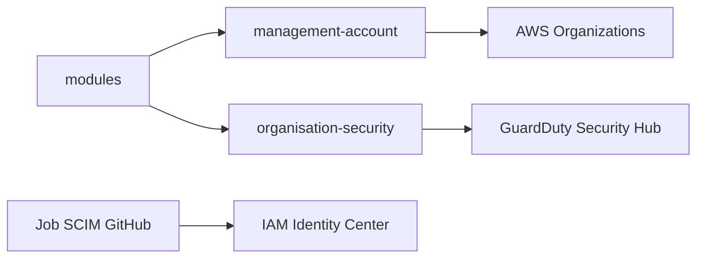

# ministryofjustice/aws-root-account

> Terraform configuration of the UK Ministry of Justice's AWS root account, with governance and security.

## The problem
Managing dozens of AWS accounts in one organization requires centralized rules, access and security.

## What it actually does
The repository manages the management account and the security account: organization, units, service control policies, SSO via GitHub and Microsoft, security contact, SOC integration. It lists the AWS services that are enabled (GuardDuty, Security Hub, Config…) and those that are not, with runbooks.

## How it is wired

## Trying it
No command documented in the README. The runbooks go through the AWS console (`aws-sso-scim-github` Lambda function).

## Cost and gotchas
An AWS Organizations root account and billed services. The pipeline cannot delete accounts: that is a manual step.

## What it is not
It is not a template reusable as is: it is specific to one organization. It serves as an example of AWS governance.

## Alternatives
No alternative named in the README.

## For you
Ignore as a tool, but worth reading as an example of multi-account AWS governance in Terraform.
