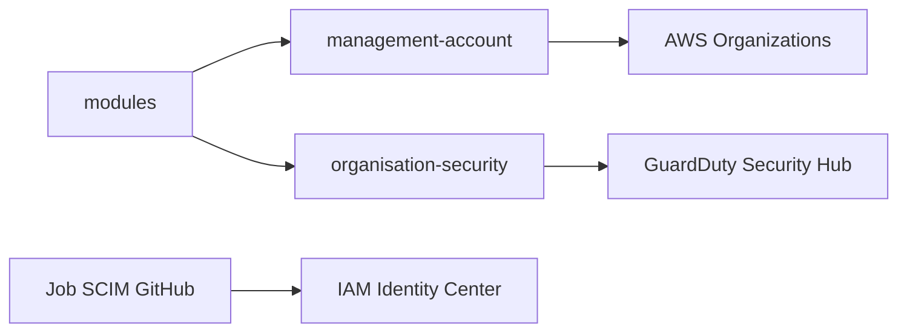

# ministryofjustice/aws-root-account

> Configuration Terraform du compte racine AWS du ministère britannique de la Justice, avec gouvernance et sécurité.

## Le problème
Gérer des dizaines de comptes AWS d'une même organisation exige des règles, des accès et une sécurité centralisés.

## Ce que ça fait vraiment
Le dépôt gère le compte de gestion et le compte de sécurité : organisation, unités, politiques de contrôle, SSO via GitHub et Microsoft, contact de sécurité, intégration au SOC. Il liste les services AWS activés (GuardDuty, Security Hub, Config…) et ceux qui ne le sont pas, avec des runbooks.

## Comment c'est branché

## Essayer
Aucune commande documentée dans le README. Les runbooks passent par la console AWS (fonction Lambda `aws-sso-scim-github`).

## Coût et pièges
Un compte racine AWS Organizations et des services facturés. Le pipeline ne peut pas supprimer de comptes : étape manuelle.

## Ce que ce n'est pas
Ce n'est pas un modèle réutilisable tel quel : il est propre à un organisme. Il sert d'exemple de gouvernance AWS.

## Alternatives
Aucune alternative nommée dans le README.

## Pour toi
Ignorer comme outil, mais à lire comme exemple de gouvernance multi-comptes AWS en Terraform.

