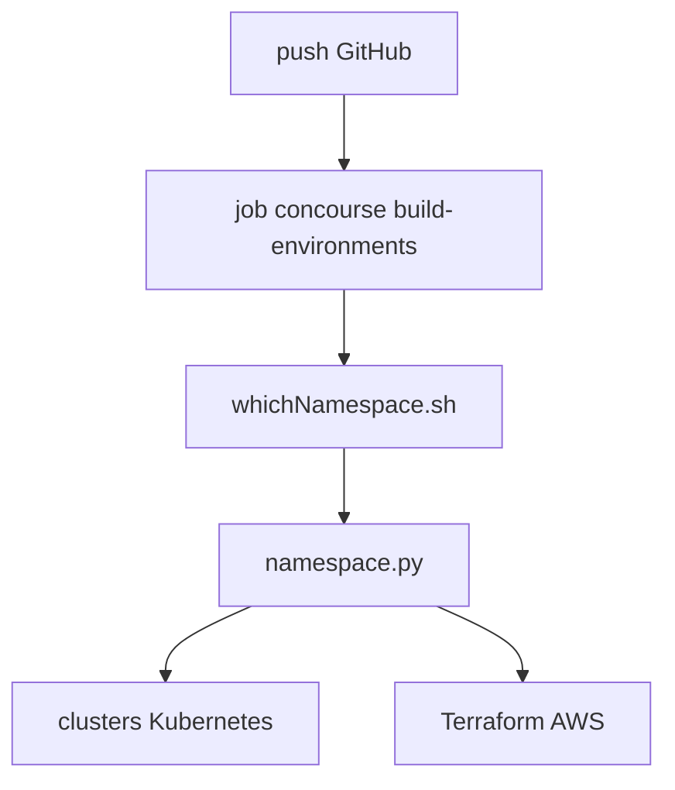

# ministryofjustice/cloud-platform-environments

> GitOps repository of the Ministry of Justice's Cloud Platform Kubernetes namespaces and AWS resources.

## The problem
Managing namespaces across several clusters by hand leads to drift and forgotten deletions.

## What it actually does
The `namespaces/cluster/namespace` folder describes the desired state. After a push, the pipeline creates the missing namespaces, deletes those that are not defined and applies the Kubernetes resources. A `terraform/` subfolder creates AWS resources with modules (S3, ECR). Concourse runs `whichNamespace.sh` then `namespace.py`.

## How it is wired

## Trying it
No command documented: you add files in `namespaces/` and push. Example module: `source = "github.com/ministryofjustice/cloud-platform-terraform-s3-bucket?ref=1.0"`.

## Cost and gotchas
Specific to the organization and its AWS accounts. A Terraform plan may appear to remove a policy when it is actually added again.

## What it is not
Not a tool reusable elsewhere as is: it is the configuration of a public platform.

## Alternatives
No alternative named in the README.

## For you
Ignore as a tool; the "one folder per namespace, one pipeline that reconciles" pattern remains readable for an MLOps platform on Kubernetes.
