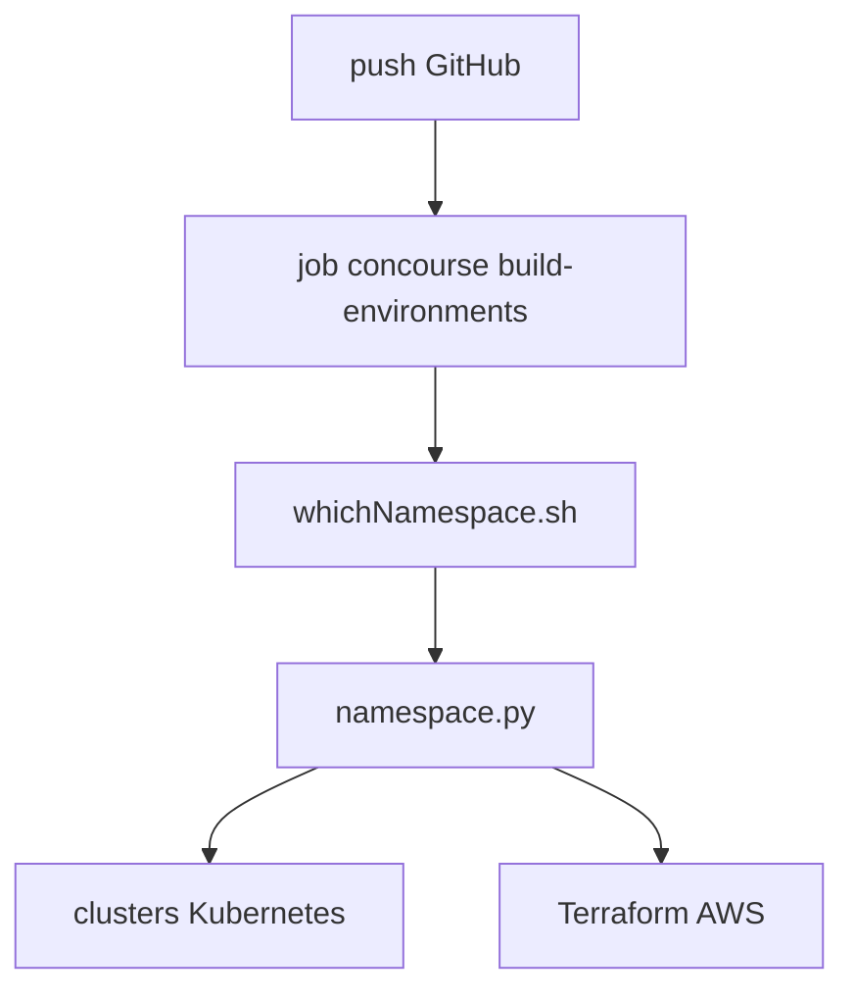

# ministryofjustice/cloud-platform-environments

> Dépôt GitOps des namespaces Kubernetes et ressources AWS de la Cloud Platform du ministère de la Justice.

## Le problème
Gérer des namespaces sur plusieurs clusters à la main mène à des écarts et des suppressions oubliées.

## Ce que ça fait vraiment
Le dossier `namespaces/cluster/namespace` décrit l'état voulu. Après un push, le pipeline crée les namespaces manquants, supprime ceux qui ne sont pas définis et applique les ressources Kubernetes. Un sous-dossier `terraform/` crée des ressources AWS avec des modules (S3, ECR). Concourse lance `whichNamespace.sh` puis `namespace.py`.

## Comment c'est branché

## Essayer
Aucune commande documentée : on ajoute des fichiers dans `namespaces/` et on pousse. Exemple de module : `source = "github.com/ministryofjustice/cloud-platform-terraform-s3-bucket?ref=1.0"`.

## Coût et pièges
Spécifique à l'organisation et à ses comptes AWS. Un plan Terraform peut sembler retirer une politique alors qu'elle est ajoutée de nouveau.

## Ce que ce n'est pas
Pas un outil réutilisable ailleurs tel quel : c'est la configuration d'une plateforme publique.

## Alternatives
Aucune alternative nommée dans le README.

## Pour toi
À ignorer comme outil ; le patron « un dossier par namespace, un pipeline qui réconcilie » reste lisible pour une plateforme MLOps sur Kubernetes.

