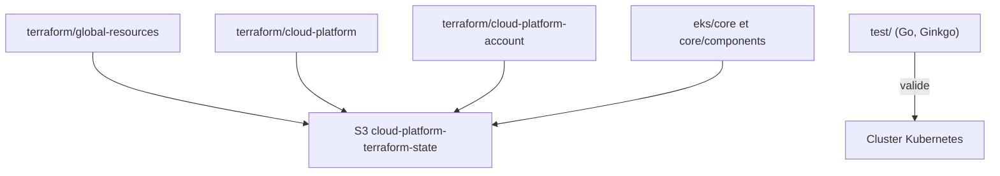

# ministryofjustice/cloud-platform-infrastructure

> Terraform and tests that create the Kubernetes cluster of the UK Ministry of Justice's Cloud Platform.

## The problem
Operating several Kubernetes clusters on AWS requires reproducible, tested infrastructure.

## What it actually does
The repository holds the Terraform scripts run by a pipeline and Go integration tests using Ginkgo. Five Terraform directories each have their own state in a shared S3 bucket, separated by workspace, which limits the blast radius of a mistake. Resources are modules in terraform/modules.

## How it is wired


## Trying it
```bash
make run-tests
# ou
go test -v ./...
cd test; ginkgo -r -v
```

## Cost and gotchas
You need an AWS account, kubectl, Terraform, aws-cli, Go and Ginkgo v2, with specific versions. Some tests require adding your ARN to OpenSearch. The README refers to a runbooks site for cluster creation.

## What it is not
It is not a reusable product: it is one particular organisation's infrastructure. Paths and bucket names are specific to the ministry.

## Alternatives
- No alternative named in the README.

## For you
Ignore: read it as an example of organising Terraform state by workspace, not as a tool to adopt.
