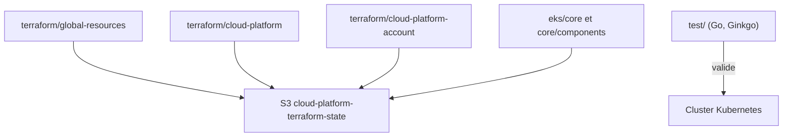

# ministryofjustice/cloud-platform-infrastructure

> Terraform et tests qui créent le cluster Kubernetes de la Cloud Platform du ministère britannique de la Justice.

## Le problème
Opérer plusieurs clusters Kubernetes sur AWS demande une infrastructure reproductible et testée.

## Ce que ça fait vraiment
Le dépôt contient les scripts Terraform exécutés par un pipeline et des tests d'intégration Go avec Ginkgo. Cinq répertoires Terraform ont chacun leur état dans un bucket S3 partagé, séparés par workspace, ce qui limite le rayon d'une erreur. Les ressources sont des modules dans terraform/modules.

## Comment c'est branché


## Essayer
```bash
make run-tests
# ou
go test -v ./...
cd test; ginkgo -r -v
```

## Coût et pièges
Il faut un compte AWS, kubectl, Terraform, aws-cli, Go et Ginkgo v2, avec des versions précises. Certains tests exigent d'ajouter son ARN à OpenSearch. Le README renvoie la création de cluster à un site de runbooks.

## Ce que ce n'est pas
Ce n'est pas un produit réutilisable : c'est l'infrastructure d'une organisation particulière. Les chemins et noms de bucket sont propres au ministère.

## Alternatives
- Aucune alternative nommée dans le README.

## Pour toi
À ignorer : à lire comme exemple d'organisation de l'état Terraform par workspace, pas comme outil à adopter.

