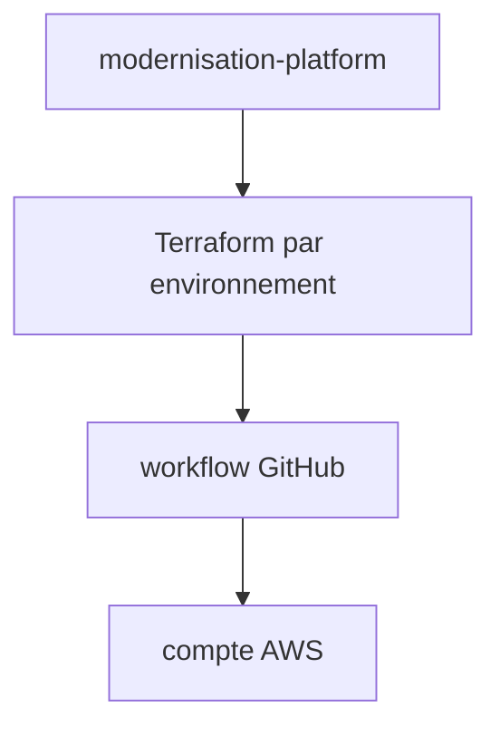

# ministryofjustice/modernisation-platform-environments

> Terraform infrastructure for the AWS environments used by the Ministry of Justice's Modernisation Platform users.

## The problem
Each team has to describe its AWS account as code without breaking the platform's guardrails.

## What it actually does
Teams add their infrastructure in Terraform, applied by GitHub workflows, one per environment. The README points to the main repository for environment requests and the user guide. The rest is not documented here.

## How it is wired

## Trying it
No documented command. Request an environment through an issue on the main repository.

## Cost and gotchas
Reserved for teams that have an account on the platform. Depends on the organisation.

## What it is not
Not a reusable public tool: it is the account configuration of a government department.

## Alternatives
No alternative named in the README.

## For you
Ignore: internal platform configuration, with no direct use for you.
