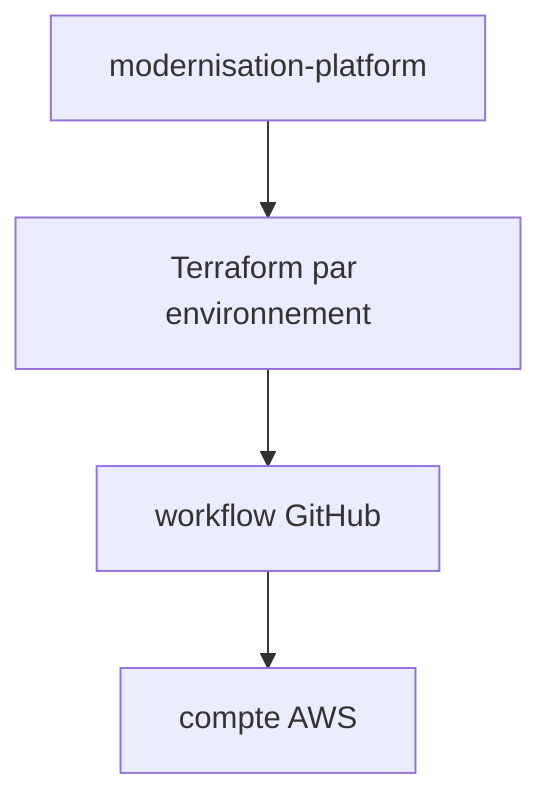

# ministryofjustice/modernisation-platform-environments

> Infrastructure Terraform des environnements AWS utilisateurs de la Modernisation Platform du ministère de la Justice.

## Le problème
Chaque équipe doit décrire son compte AWS en code sans casser les garde-fous de la plateforme.

## Ce que ça fait vraiment
Les équipes ajoutent leur infrastructure en Terraform, appliquée par des workflows GitHub, un par environnement. Le README renvoie au dépôt principal pour les demandes d'environnement et le guide utilisateur. Le reste n'est pas documenté ici.

## Comment c'est branché

## Essayer
Aucune commande documentée. Demander un environnement par une issue sur le dépôt principal.

## Coût et pièges
Réservé aux équipes qui ont un compte sur la plateforme. Dépend de l'organisation.

## Ce que ce n'est pas
Pas un outil public réutilisable : c'est la configuration de comptes d'une administration.

## Alternatives
Aucune alternative nommée dans le README.

## Pour toi
À ignorer : configuration interne d'une plateforme, sans usage direct pour toi.

