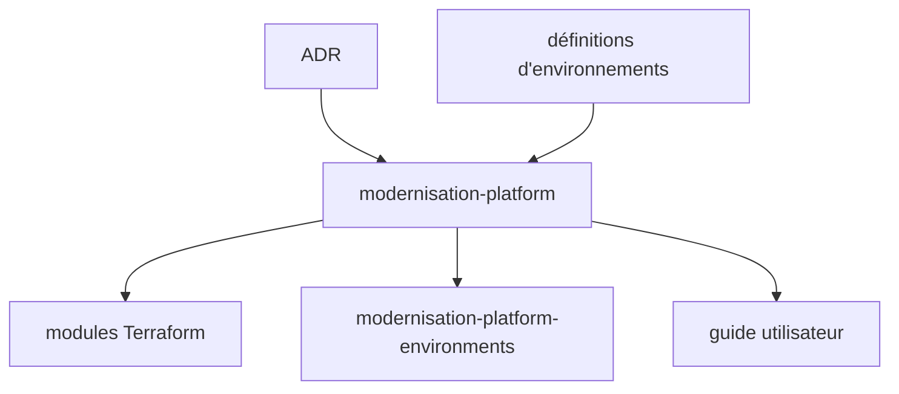

# ministryofjustice/modernisation-platform

> Central repository of the UK Ministry of Justice's AWS hosting platform: infrastructure as code and decisions.

## The problem
Applications that do not go on the Cloud Platform need managed hosting with shared accounts, network and guardrails.

## What it actually does
Contains the ADRs, the environment definitions, the Terraform infrastructure and the source of the user guide. The README references reusable Terraform modules (bastion, ECS, S3, RDS, WAF, ALB, SSM patching, GitHub OIDC) and tools (instance scheduler in Go, GitHub actions).

## How it is wired

## Trying it
No documented command. See the user guide and the module repositories.

## Cost and gotchas
Everything is anchored in the Ministry's AWS accounts: unusable as is without that organization. 273 open issues.

## What it is not
Not a product installable elsewhere; only some modules are presented as reusable.

## Alternatives
No alternative named in the README.

## For you
Ignore as a tool, but readable as an example of an AWS platform governed in Terraform if you are designing an MLOps platform.
