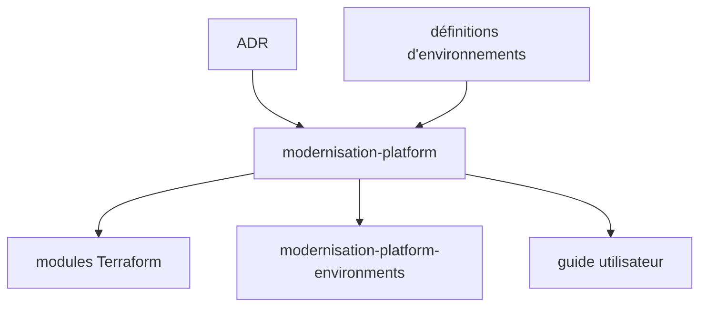

# ministryofjustice/modernisation-platform

> Dépôt central de la plateforme d'hébergement AWS du ministère de la Justice britannique : infra as code et décisions.

## Le problème
Des applications qui ne vont pas sur la Cloud Platform ont besoin d'un hébergement géré avec comptes, réseau et garde-fous communs.

## Ce que ça fait vraiment
Contient les ADR, les définitions d'environnements, l'infrastructure Terraform et le source du guide utilisateur. Le README référence des modules Terraform réutilisables (bastion, ECS, S3, RDS, WAF, ALB, patching SSM, OIDC GitHub) et des outils (instance scheduler en Go, actions GitHub).

## Comment c'est branché

## Essayer
Aucune commande documentée. Voir le guide utilisateur et les dépôts de modules.

## Coût et pièges
Tout est ancré dans les comptes AWS du ministère : inutilisable tel quel sans cette organisation. 273 issues ouvertes.

## Ce que ce n'est pas
Pas un produit installable ailleurs ; seuls certains modules sont présentés comme réutilisables.

## Alternatives
Aucune alternative nommée dans le README.

## Pour toi
À ignorer comme outil, mais lisible comme exemple de plateforme AWS gouvernée en Terraform si tu conçois une plateforme MLOps.

