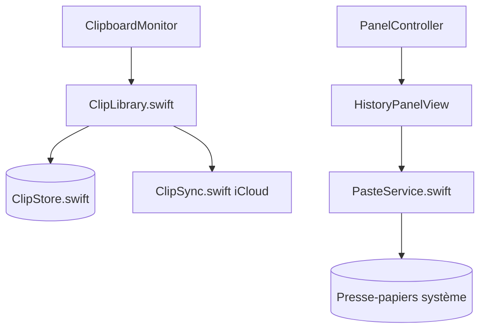

# minsang-alt/PasteClip

> Clipbara: a clipboard history manager for macOS, local and free, for people who copy a lot.

## The problem
The macOS clipboard only keeps the last item copied. Competing managers are often paid.

## What it actually does
Keeps the history of what is copied (text, images, links, files, colors) in SwiftData, locally. A shortcut opens a panel with search, Pinboards and Quick Look preview. Choosing a clip puts it back on the clipboard; the user pastes it themselves. Excluded apps (password managers) are not recorded.

## How it is wired


## Trying it
```bash
brew install --cask mobrava/tap/clipbara
```

## Cost and gotchas
Free on the Mac App Store and GitHub. Requires macOS 14 or later. The App Store and DMG builds have different identifiers and therefore separate histories: run only one of them.

## What it is not
It is not a tool that pastes for you: it does not simulate keystrokes. The README promises no synchronization between Macs (JSON export/import). Images cannot be pasted into a terminal.

## Alternatives
Paste (mentioned in the motivation): the paid, subscription-based version of the same card idea.

## For you
Useful on a macOS workstation to retrieve a snippet or a command copied earlier; unrelated to the data/AI pipeline, so one to watch rather than adopt.
