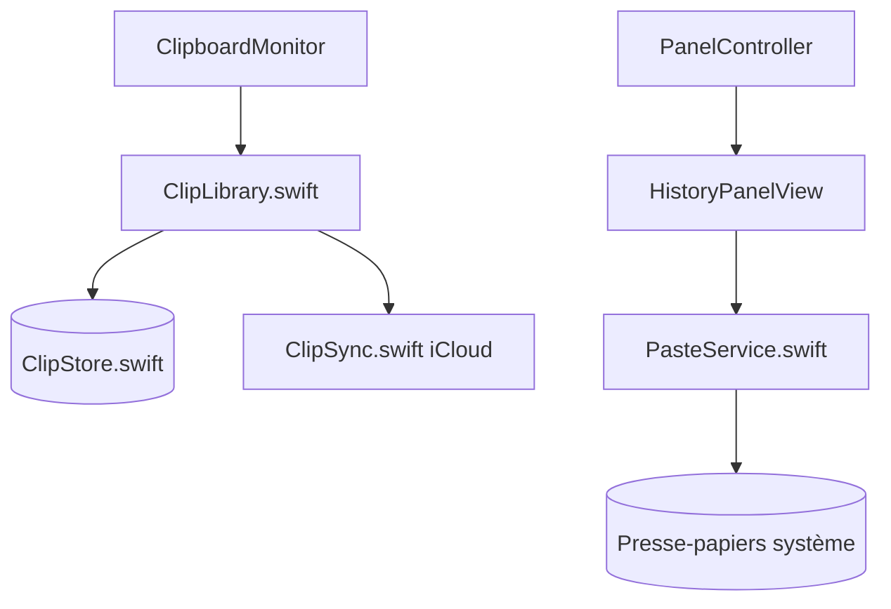

# minsang-alt/PasteClip

> Clipbara : gestionnaire d'historique du presse-papiers pour macOS, local, gratuit, pour qui copie beaucoup.

## Le problème
Le presse-papiers macOS ne garde que le dernier élément copié. Les gestionnaires concurrents sont souvent payants.

## Ce que ça fait vraiment
Garde l'historique de ce qui est copié (texte, images, liens, fichiers, couleurs) dans SwiftData, en local. Un raccourci ouvre un panneau avec recherche, Pinboards et aperçu Quick Look. Choisir un clip le remet dans le presse-papiers ; l'utilisateur colle lui-même. Les applis exclues (gestionnaire de mots de passe) ne sont pas enregistrées.

## Comment c'est branché


## Essayer
```bash
brew install --cask mobrava/tap/clipbara
```

## Coût et pièges
Gratuit sur le Mac App Store et GitHub. Il faut macOS 14 ou plus. Les builds App Store et DMG ont des identifiants différents donc des historiques séparés : n'en lancer qu'un.

## Ce que ce n'est pas
Ce n'est pas un outil qui colle à ta place : il ne simule pas de frappe. Aucune synchronisation entre Mac n'est promise par le README (export/import JSON). Les images ne se collent pas dans un terminal.

## Alternatives
Paste (cité dans la motivation) : version payante par abonnement de la même idée de cartes.

## Pour toi
Utile en poste de travail macOS pour récupérer un extrait ou une commande copiée plus tôt ; sans lien avec le pipeline data/IA, donc à surveiller plutôt qu'adopter.

