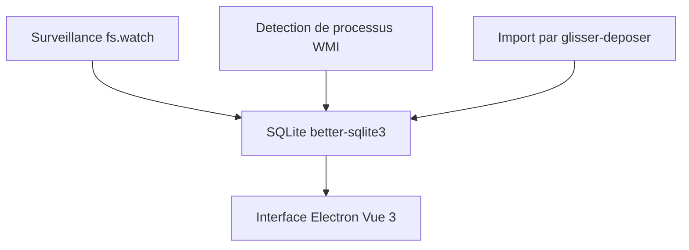

# miragecoa/AI-Cubby

> Windows application that logs opened files and programs so you can find them by search.

## The problem
Finding a tool or file you used six months ago, whose name you no longer remember.

## What it actually does
It watches in the background the opened files, desktop shortcuts and launched processes, and records the number of openings and usage time. Text search, tags, multiple profiles, folders as resources. The AI features (natural-language search, ranking) are "coming soon". Data in local SQLite.

## How it is wired

Simplified diagram based on the sheet, no diagram provided.

## Trying it
```bash
git clone https://github.com/miragecoa/AI-Resource-Manager.git
cd AI-Resource-Manager/app
npm install --ignore-scripts
npm run rebuild
npm run dev
```

## Cost and gotchas
Free, Windows 10 or later, 80 to 120 MB of memory advertised. AGPL-3.0. Building requires Node and a native module (better-sqlite3).

## What it is not
Not yet an AI application: the AI features are announced, not delivered. Not available on macOS or Linux. It records your usage of the machine, locally.

## Alternatives
- Everything: file name search only, without usage history.
- Playnite: games only.

## For you
Ignore: a Windows utility for personal use, and the AI part does not exist yet.
