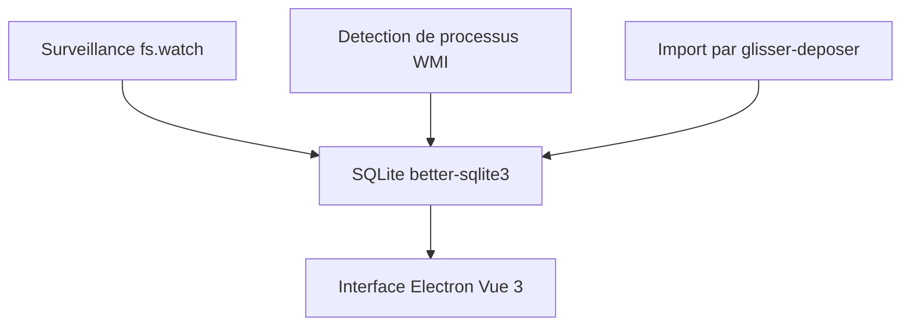

# miragecoa/AI-Cubby

> Application Windows qui journalise les fichiers et programmes ouverts pour les retrouver par recherche.

## Le problème
Retrouver un outil ou un fichier utilisé il y a six mois, dont on ne se rappelle plus le nom.

## Ce que ça fait vraiment
Elle surveille en tâche de fond les fichiers ouverts, les raccourcis du bureau et les processus lancés, et note nombre d'ouvertures et temps d'usage. Recherche texte, étiquettes, profils multiples, dossiers comme ressources. Les fonctions IA (recherche en langage naturel, classement) sont « à venir ». Données en SQLite local.

## Comment c'est branché

Schéma simplifié d'après la fiche, sans diagramme fourni.

## Essayer
```bash
git clone https://github.com/miragecoa/AI-Resource-Manager.git
cd AI-Resource-Manager/app
npm install --ignore-scripts
npm run rebuild
npm run dev
```

## Coût et pièges
Gratuit, Windows 10 ou plus, 80 à 120 Mo de mémoire annoncés. AGPL-3.0. La compilation demande Node et un module natif (better-sqlite3).

## Ce que ce n'est pas
Pas encore une application d'IA : les fonctions IA sont annoncées, pas livrées. Pas disponible sur macOS ni Linux. Elle enregistre ton usage de la machine, en local.

## Alternatives
- Everything : recherche de noms de fichiers seulement, sans historique d'usage.
- Playnite : réservé aux jeux.

## Pour toi
À ignorer : utilitaire Windows pour usage personnel, et la partie IA n'existe pas encore.

