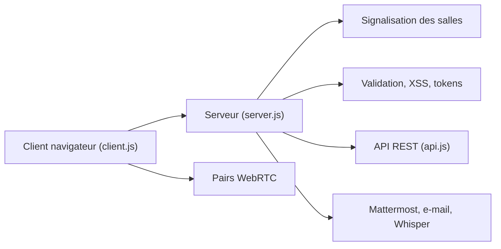

# miroslavpejic85/mirotalk

> Self-hosted peer-to-peer WebRTC video conferencing, with chat, whiteboard and REST API.

## The problem
Video conferencing services impose time limits, paid plans and third-party handling of your data.

## What it actually does
A Node server provides room signaling; browsers establish WebRTC communication peer to peer. Features: up to 8K at 60 fps advertised, screen sharing, recording, Markdown chat, whiteboard, file sharing, ChatGPT integration, speech recognition, OIDC, JWT, room passwords, REST API, Slack/Mattermost, 133 languages.

## How it is wired


## Trying it
```bash
git clone https://github.com/miroslavpejic85/mirotalk.git
cd mirotalk
cp .env.template .env
cp app/src/config.template.js app/src/config.js
npm install
npm start
```

## Cost and gotchas
Free, one server to host; Docker Compose possible. AGPL-3.0 license: modifications served over a network must be published, otherwise a paid commercial license (CodeCanyon). The README contains numerous sponsor mentions.

## What it is not
In pure peer-to-peer, quality drops as the number of participants grows; the README gives no limit. Not a data/AI tool: the AI is limited to a ChatGPT integration.

## Alternatives
Not documented in the README: no alternative named (generic comparison with "other solutions").

## For you
Outside your data/AI scope: ignore, unless you have a specific need for self-hosted video conferencing, keeping the AGPL constraint in mind.
