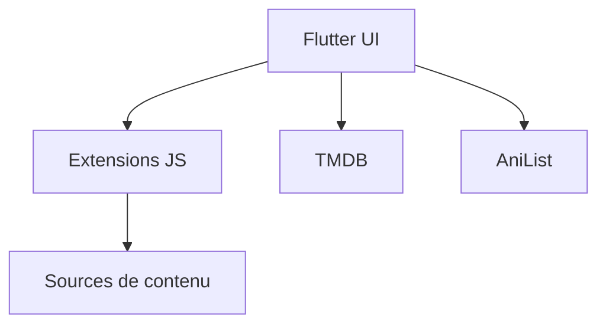

# miru-project/miru-app

> Flutter app for Windows and Android to read videos, comics and novels through JavaScript extensions.

## The problem
Watching or reading content from multiple sources forces you to switch between apps.

## What it actually does
A Flutter app that loads extensions written in JavaScript (customizable extension repository), fetches TMDB metadata, tracks AniList and handles HTTP/SOCKS proxies. Linux is not supported (quickjs).

## How it is wired

Diagram based on the README, no diagram provided.

## Trying it
```bash
flutter pub get
flutter run
flutter build apk
flutter build windows
```

## Cost and gotchas
Free. Last push December 2025. The content depends on third-party extensions whose legality is not addressed in the README.

## What it is not
Not a standalone reader: without an extension, there is nothing to read.

## Alternatives
No alternative named.

## For you
Ignore: entertainment, outside data/AI/MLOps.
