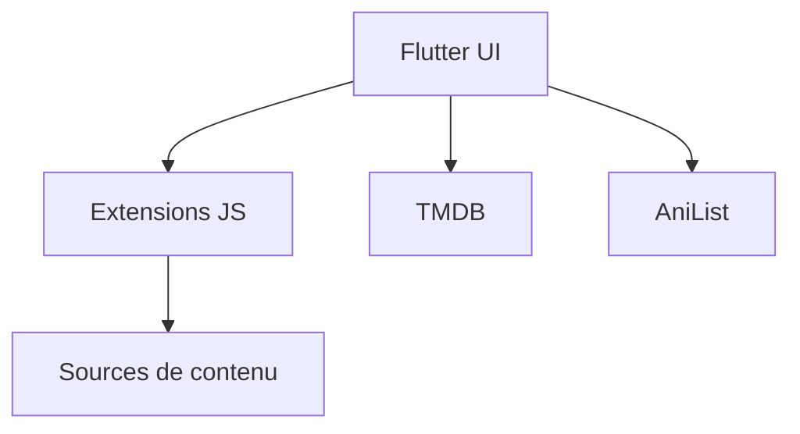

# miru-project/miru-app

> Application Flutter Windows et Android pour lire vidéos, BD et romans via des extensions JavaScript.

## Le problème
Regarder ou lire du contenu issu de sources multiples oblige à changer d'application.

## Ce que ça fait vraiment
Application Flutter qui charge des extensions écrites en JavaScript (dépôt d'extensions personnalisable), récupère les métadonnées TMDB, suit AniList et gère des proxys HTTP/SOCKS. Linux non pris en charge (quickjs).

## Comment c'est branché

Schéma d'après le README, pas de diagramme fourni.

## Essayer
```bash
flutter pub get
flutter run
flutter build apk
flutter build windows
```

## Coût et pièges
Gratuit. Dernier push décembre 2025. Le contenu dépend d'extensions tierces dont la légalité n'est pas traitée dans le README.

## Ce que ce n'est pas
Pas un lecteur autonome : sans extension, rien à lire.

## Alternatives
Aucune alternative nommée.

## Pour toi
Ignorer : divertissement, hors data/IA/MLOps.

