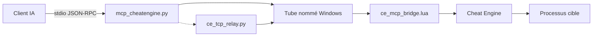

# miscusi-peek/cheatengine-mcp-bridge

> MCP server that gives an AI assistant access to Cheat Engine: memory, debugging, disassembly, on Windows.

## The problem
Studying a program's memory and code in a debugger is slow; everything has to be driven by hand.

## What it actually does
A Python FastMCP server (`mcp_cheatengine.py`) relays ~180 tools to a Lua script loaded in Cheat Engine (`ce_mcp_bridge.lua`) through a Windows named pipe. The tools cover memory reading and analysis, disassembly, RTTI, breakpoints, process management, symbols, `.CT` tables and DBVM/DBK functions. Some tools modify or inject code into a process; shell commands are disabled by default (`CE_MCP_ALLOW_SHELL`). A TCP relay lets you host the server outside Windows.

## How it is wired


## Trying it
```bash
pip install -r MCP_Server/requirements.txt
python MCP_Server/test_mcp.py
```
Then load `MCP_Server/ce_mcp_bridge.lua` in Cheat Engine (`File` → `Execute Script`) and declare the server in the client's MCP config.

## Cost and gotchas
Free; Windows, Cheat Engine and, for DBVM, a kernel mode. The README requires disabling "Query memory region routines" to avoid BSODs. The TCP relay has no authentication: keep it on trusted interfaces.

## What it is not
Not a supervised product: the author presents it as educational and endorses neither cheating in multiplayer nor violating terms of use. Use it only on your own programs or with authorization (audit, lawful reverse engineering). The tests depend on a live Cheat Engine instance.

## Alternatives
No alternative named in the README.

## For you
Worth watching: an interesting demonstration of driving a low-level tool through MCP, but outside the data/MLOps profile and for sensitive use; keep it for authorized reverse engineering.
