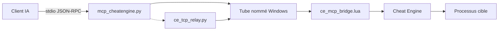

# miscusi-peek/cheatengine-mcp-bridge

> Serveur MCP qui donne à un assistant IA accès à Cheat Engine : mémoire, débogage, désassemblage, sous Windows.

## Le problème
Étudier la mémoire et le code d'un programme dans un débogueur est long ; il faut tout piloter à la main.

## Ce que ça fait vraiment
Un serveur FastMCP Python (`mcp_cheatengine.py`) relaie ~180 outils vers un script Lua chargé dans Cheat Engine (`ce_mcp_bridge.lua`) par tube nommé Windows. Les outils couvrent lecture et analyse de mémoire, désassemblage, RTTI, points d'arrêt, gestion de processus, symboles, tables `.CT` et fonctions DBVM/DBK. Certains outils modifient ou injectent du code dans un processus ; les commandes shell sont désactivées par défaut (`CE_MCP_ALLOW_SHELL`). Un relais TCP permet d'héberger le serveur hors de Windows.

## Comment c'est branché


## Essayer
```bash
pip install -r MCP_Server/requirements.txt
python MCP_Server/test_mcp.py
```
Puis charger `MCP_Server/ce_mcp_bridge.lua` dans Cheat Engine (`File` → `Execute Script`) et déclarer le serveur dans la config MCP du client.

## Coût et pièges
Gratuit ; Windows, Cheat Engine et, pour DBVM, un mode noyau. Le README exige de désactiver « Query memory region routines » pour éviter des BSOD. Le relais TCP n'a pas d'authentification : le garder sur des interfaces de confiance.

## Ce que ce n'est pas
Pas un produit encadré : l'auteur le présente comme éducatif et ne cautionne ni la triche en multijoueur ni la violation des conditions d'usage. N'utiliser que sur ses propres programmes ou avec autorisation (audit, rétro-ingénierie licite). Les tests dépendent d'une instance Cheat Engine vivante.

## Alternatives
Aucune alternative nommée dans le README.

## Pour toi
À surveiller : démonstration intéressante de pilotage d'un outil bas niveau par MCP, mais hors profil data/MLOps et à usage sensible ; garde-le pour de la rétro-ingénierie autorisée.

