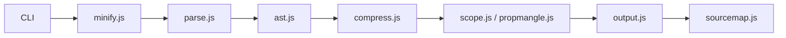

# mishoo/UglifyJS

> JavaScript parser, compressor, "mangler" and beautifier, as a library and on the command line.

## The problem
JavaScript shipped as is is heavy: long names, whitespace, dead code.

## What it actually does
Parses the source into an AST, optionally applies compression and renaming of variables or properties, then regenerates JavaScript and a source map. The `minify()` function chains these steps. Also accepts a SpiderMonkey AST as input. The "mangle without compress" mode is 3 to 5 times faster according to the README.

## How it is wired


## Trying it
```bash
npm install uglify-js -g
uglifyjs file.js -c -m -o file.min.js
uglifyjs file.js -m
uglifyjs example.js -c -m --mangle-props
```

## Cost and gotchas
Free. `--mangle-props` can break code (README warning) and the compressor makes assumptions listed at length (no `arguments.callee`, etc.).

## What it is not
It is not a transpiler: for exotic syntaxes, the README refers to Babel before Uglify. Last push in November 2024.

## Alternatives
- Babel: to run upstream for syntaxes not handled.
- Acorn: parser usable via `-p acorn`.

## For you
Ignore: a JavaScript build tool, unrelated to a data/AI workflow, and not very active since late 2024.
