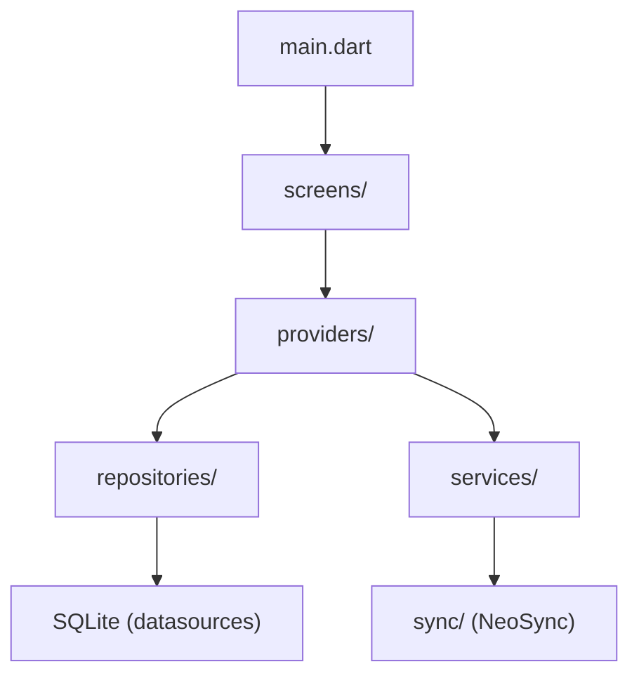

# misobadev/neostation-frontend

> Cross-platform Flutter interface to launch retro games via RetroArch and emulators.

## The problem
Managing ROM collections and launching the right emulator with the right arguments is tedious, especially on a handheld console.

## What it actually does
- Organizes ROMs and platforms, creates `.m3u` playlists for multi-disc games.
- Detects and configures RetroArch and standalone emulators; gamepad and keyboard.
- Fetches metadata (ScreenScraper) and achievements (RetroAchievements); online save synchronization (NeoSync).
- Runs on Windows, Linux, macOS and Android; twelve languages.

## How it is wired
Simplified diagram based on the sheet, no diagram provided.


## Trying it
```bash
git clone https://github.com/misobadev/neostation-frontend.git
cd neostation-frontend
flutter pub get
flutter run --dart-define=SCREENSCRAPER_DEV_ID=your_id --dart-define=SCREENSCRAPER_DEV_PASSWORD=your_password
```

## Cost and gotchas
Free. Building requires Flutter 3.9.2 or later (exact version in `.fvmrc`, lockfile enforced) and ScreenScraper developer credentials. On Steam Deck, launch the AppImage from Steam, otherwise the triggers do not respond.

## What it is not
Not an emulator: it launches RetroArch or others. Not shipped with games.

## Alternatives
No alternative mentioned in the README.

## For you
Ignore: retro gaming interface unrelated to your data / AI work.
