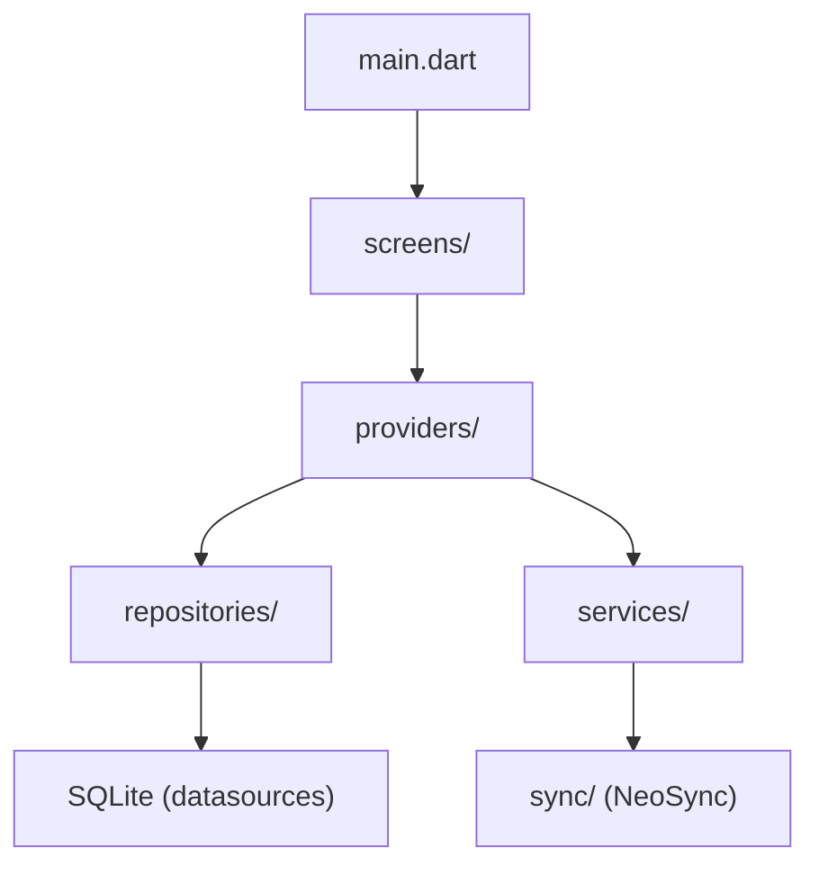

# misobadev/neostation-frontend

> Interface Flutter multiplateforme pour lancer des jeux rétro via RetroArch et émulateurs.

## Le problème
Gérer des collections de ROMs et lancer le bon émulateur avec les bons arguments est fastidieux, surtout sur console portable.

## Ce que ça fait vraiment
- Organise ROMs et plateformes, crée des playlists `.m3u` pour les jeux multi-disques.
- Détecte et configure RetroArch et des émulateurs autonomes ; manette et clavier.
- Récupère métadonnées (ScreenScraper) et succès (RetroAchievements) ; synchronisation de sauvegardes en ligne (NeoSync).
- Fonctionne sous Windows, Linux, macOS et Android ; douze langues.

## Comment c'est branché
Schéma simplifié d'après la fiche, sans diagramme fourni.


## Essayer
```bash
git clone https://github.com/misobadev/neostation-frontend.git
cd neostation-frontend
flutter pub get
flutter run --dart-define=SCREENSCRAPER_DEV_ID=your_id --dart-define=SCREENSCRAPER_DEV_PASSWORD=your_password
```

## Coût et pièges
Gratuit. Compiler demande Flutter 3.9.2 ou plus (version exacte dans `.fvmrc`, lockfile imposé) et des identifiants développeur ScreenScraper. Sous Steam Deck, lancer l'AppImage depuis Steam, sinon les gâchettes ne répondent pas.

## Ce que ce n'est pas
Pas un émulateur : il lance RetroArch ou d'autres. Pas fourni avec des jeux.

## Alternatives
Aucune alternative citée dans le README.

## Pour toi
À ignorer : interface de jeu rétro sans lien avec ton métier data / IA.

