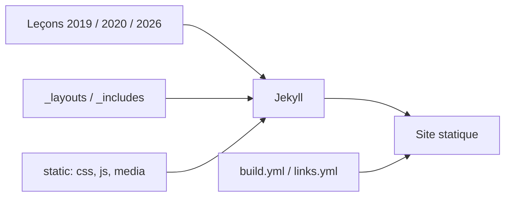

# missing-semester/missing-semester

> Source of the website for the course "The Missing Semester": the everyday tools that university forgets to teach.

## The problem
Computer science curricula teach little about the shell, the editor, Git, debugging or automation.

## What it actually does
The repository is the course's Jekyll site: Markdown lessons for the 2019, 2020 and 2026 editions, shared layouts, includes for images and videos, subtitles, example files. Two GitHub Actions workflows check the build and broken links. The lesson content is not in the README.

## How it is wired


## Trying it
```bash
bundle exec jekyll serve -w
docker compose up --build
```

## Cost and gotchas
Free. Ruby and Bundler required, or Docker to avoid them. License not identified by GitHub.

## What it is not
Not the "ready to read" course: it is the site's code, reading is done on the published site.

## Alternatives
No alternative named in the README.

## For you
Adopt: shell, Git and debugging are everyday MLOps, and this course fills those gaps at zero cost.
