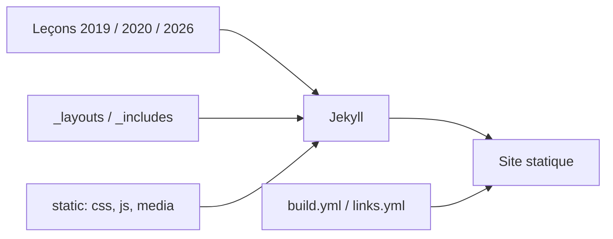

# missing-semester/missing-semester

> Source du site du cours « The Missing Semester » : les outils du quotidien que l'université oublie d'enseigner.

## Le problème
Les cursus d'informatique enseignent peu le shell, l'éditeur, Git, le débogage ou l'automatisation.

## Ce que ça fait vraiment
Le dépôt est le site Jekyll du cours : leçons en Markdown pour les éditions 2019, 2020 et 2026, mises en page partagées, includes pour images et vidéos, sous-titres, fichiers d'exemple. Deux workflows GitHub Actions vérifient la compilation et les liens cassés. Le contenu des leçons n'est pas dans le README.

## Comment c'est branché


## Essayer
```bash
bundle exec jekyll serve -w
docker compose up --build
```

## Coût et pièges
Gratuit. Ruby et Bundler requis, ou Docker pour l'éviter. Licence non identifiée par GitHub.

## Ce que ce n'est pas
Pas le cours « prêt à lire » : c'est le code du site, la lecture se fait sur le site publié.

## Alternatives
Aucune alternative nommée dans le README.

## Pour toi
À adopter : shell, Git et débogage sont le quotidien du MLOps, et ce cours comble ces trous à coût nul.

