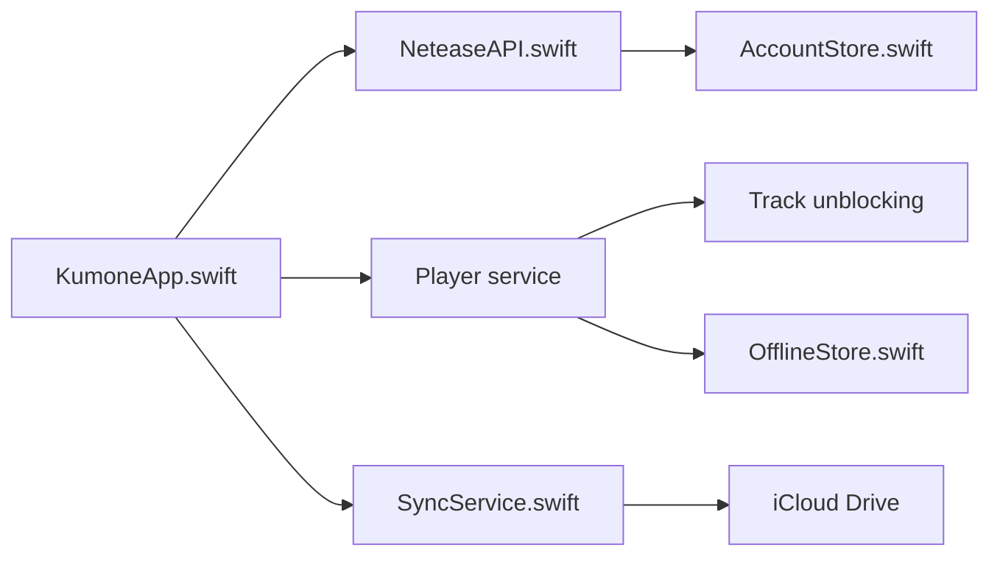

# missuo/kumone

> Native SwiftUI macOS and iOS client for NetEase Cloud Music, aimed at users of that service.

## The problem
The official NetEase Cloud Music client is not native on Mac. Without an alternative, there is no fine integration with macOS (media keys, Control Center).

## What it actually does
Logs in by QR code and calls `music.163.com` directly: the weapi/eapi encryption is reimplemented in Swift, with no third-party server. Playback with AVPlayer, synchronized lyrics (panel, floating window), library, playlists, search. Unavailable tracks are resolved via third-party sources (Kuwo, Kugou, pyncmd). iCloud Drive sync between Mac and iPhone; CarPlay optional, subject to an Apple entitlement.

## How it is wired


## Trying it
```bash
brew install owo-network/brew/kumone --cask
# ou, pour compiler (macOS 15+, Xcode 26+)
swift build
Scripts/build-app.sh
Scripts/compile_and_run.sh
```

## Cost and gotchas
Free, but a NetEase account is needed; lossless Hi-Res requires the 黑胶 VIP. iOS: unsigned IPA, to be sideloaded with your Apple ID; CarPlay requires an Apple entitlement that is rarely granted.

## What it is not
Not an official client: it will be neither on the App Store nor on TestFlight. It depends on NetEase's private API, which may change. Bypassing greyed-out tracks via third-party sources is a legal gray area.

## Alternatives
- YesPlayMusic: MIT project that inspired the endpoints and the design.
- kaset: MIT project cited for the design system.
- Sonimbus: NetEase client for Apple TV (tvOS).

## For you
Watch: young project (created in August 2026), single maintainer, outside your data/AI scope; useless unless you listen to NetEase on Mac, and LGPL-3.0 to know about if you reuse any of its code.
