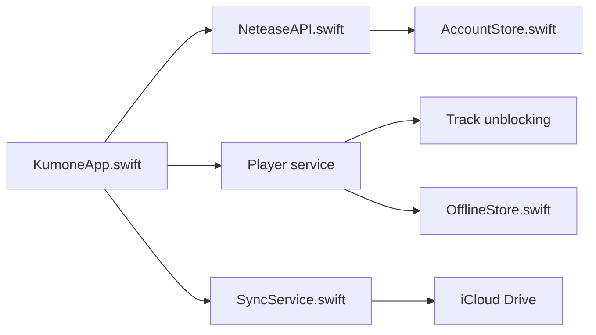

# missuo/kumone

> Client macOS et iOS natif en SwiftUI pour NetEase Cloud Music, destiné aux utilisateurs de ce service.

## Le problème
Le client officiel de NetEase Cloud Music n'est pas natif Mac. Sans alternative, pas d'intégration fine avec macOS (touches média, Control Center).

## Ce que ça fait vraiment
Se connecte par QR code et appelle directement `music.163.com` : le chiffrement weapi/eapi est réimplémenté en Swift, sans serveur tiers. Lecture avec AVPlayer, paroles synchronisées (panneau, fenêtre flottante), bibliothèque, playlists, recherche. Les morceaux indisponibles sont résolus via des sources tierces (Kuwo, Kugou, pyncmd). Synchro iCloud Drive entre Mac et iPhone ; CarPlay en option, sous réserve d'un entitlement Apple.

## Comment c'est branché


## Essayer
```bash
brew install owo-network/brew/kumone --cask
# ou, pour compiler (macOS 15+, Xcode 26+)
swift build
Scripts/build-app.sh
Scripts/compile_and_run.sh
```

## Coût et pièges
Gratuit, mais il faut un compte NetEase ; le Hi-Res sans perte exige le VIP 黑胶. iOS : IPA non signé, à installer par sideload avec son Apple ID ; CarPlay demande un entitlement Apple rarement accordé.

## Ce que ce n'est pas
Pas un client officiel : il ne sera ni sur l'App Store ni sur TestFlight. Il dépend de l'API privée de NetEase, qui peut changer. Le contournement des morceaux grisés via sources tierces est une zone juridique floue.

## Alternatives
- YesPlayMusic : projet MIT qui a inspiré les endpoints et le design.
- kaset : projet MIT cité pour le système de design.
- Sonimbus : client NetEase pour Apple TV (tvOS).

## Pour toi
Surveiller : projet jeune (créé en août 2026), mainteneur unique, hors de ton périmètre data/IA ; sans utilité sauf si tu écoutes NetEase sur Mac, et LGPL-3.0 à connaître si tu en réutilises du code.

