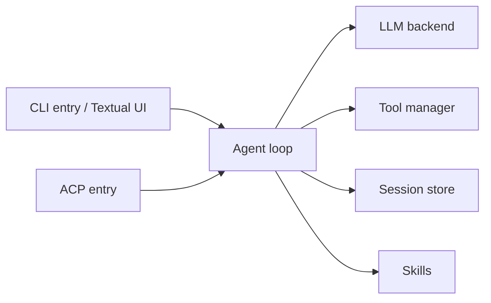

# mistralai/mistral-vibe

> Mistral's command-line coding assistant, with tools, sub-agents, skills and MCP.

## The problem
Exploring and modifying code through natural language from the terminal, with Mistral models.

## What it actually does
Agent loop with `read`, `write_file`, `edit`, `bash`, `grep`, `todo`, `task` (sub-agents) and `ask_user_question` tools. Profiles `ask`, `plan`, `accept-edits` and `auto-approve`. Skills in the Agent Skills format, MCP servers, before/after-tool hooks, session resume, git worktrees, programmatic mode with cost caps. ACP entry point for editors.

## How it is wired


## Trying it
```bash
curl -LsSf https://mistral.ai/vibe/install.sh | bash
uv tool install mistral-vibe
vibe
```

## Cost and gotchas
Mistral key required, cost on your account (`--max-price` to cap it). Telemetry is on by default; `enable_telemetry = false` turns it off. Programmatic mode approves everything with no tool restrictions. Unix targeted, Windows tolerated.

## What it is not
Not provider-independent in the strict sense: optimized for Mistral, even though other providers are configurable. Voice is experimental.

## Alternatives
The README names no alternative.

## For you
Watch: fine if you want a European coding agent, but the telemetry and the risk of auto-approval call for vigilance.
