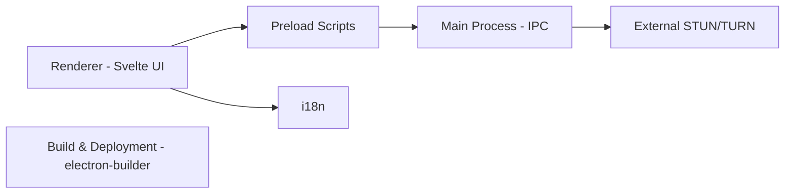

# mistweaverco/bananas

> Peer-to-peer screen sharing and conferencing app (p2p.kiwi), no account, for Mac, Windows and Linux.

## The problem
Sharing your screen often requires an account and an intermediate media server.

## What it actually does
Electron application with a Svelte interface: peer-to-peer WebRTC connection; optional STUN and TURN servers only exchange ICE information. End-to-end encryption: application keys managed by MLS, media encrypted with SFrame, on top of DTLS-SRTP. Oddity: the repository is called "bananas" but the README describes "p2p.kiwi".

## How it is wired


## Trying it
```bash
paru -S p2p-kiwi-bin
yay -S p2p-kiwi-bin
brew install --cask p2p-kiwi
```

## Cost and gotchas
Free. The encryption cannot be verified with DTLS-SRTP alone (README warning). No signaling server for chat.

## What it is not
Not a managed multi-user webinar tool.

## Alternatives
No alternative named in the README.

## For you
Keep an eye on it: unrelated to data/AI/MLOps, useful only as a screen sharing tool.
