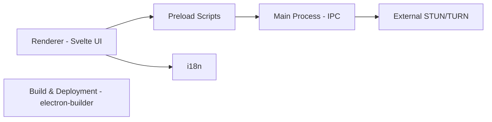

# mistweaverco/bananas

> Application de partage d'écran et de conférence pair à pair (p2p.kiwi), sans compte, pour Mac, Windows et Linux.

## Le problème
Partager son écran impose souvent un compte et un serveur de médias intermédiaire.

## Ce que ça fait vraiment
Application Electron avec interface Svelte : connexion WebRTC pair à pair ; des serveurs STUN et TURN optionnels échangent seulement les informations ICE. Chiffrement de bout en bout : clés applicatives gérées par MLS, médias chiffrés avec SFrame, par-dessus DTLS-SRTP. Anomalie : le dépôt s'appelle « bananas » mais le README décrit « p2p.kiwi ».

## Comment c'est branché


## Essayer
```bash
paru -S p2p-kiwi-bin
yay -S p2p-kiwi-bin
brew install --cask p2p-kiwi
```

## Coût et pièges
Gratuit. Le chiffrement ne se vérifie pas avec DTLS-SRTP seul (avertissement du README). Pas de serveur de signalisation pour chat.

## Ce que ce n'est pas
Pas un outil de webinaire multi-utilisateurs géré.

## Alternatives
Aucune alternative nommée dans le README.

## Pour toi
À surveiller : sans lien avec data/IA/MLOps, utile seulement comme outil de partage d'écran.

