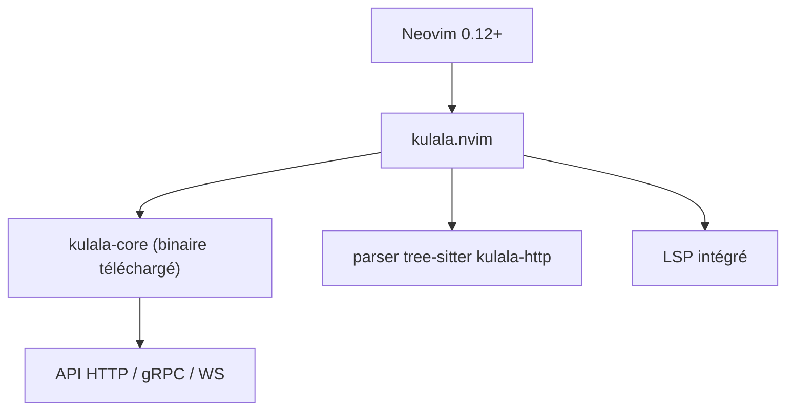

# mistweaverco/kulala.nvim

> HTTP, GraphQL, gRPC and WebSocket client for Neovim, compatible with JetBrains `.http` files.

## The problem
Testing APIs from the editor avoids switching to Postman or a terminal.

## What it actually does
You run requests written in `.http` files (variables, JavaScript scripts, assertions, Basic, Bearer, OAuth2, AWS, SSL authentication), with response formatting, an OpenAPI explorer, built-in LSP completion and a scratchpad. The engine is the `kulala-core` binary, downloaded automatically from core.kulala.app.

## How it is wired
Simplified diagram based on the sheet, no diagram provided.


## Trying it
```lua
require("lazy").setup({
  { "dont-be-evil-company/kulala.nvim", ft = {"http", "rest", "javascript"}, opts = {} },
})
```

## Cost and gotchas
Neovim 0.12+, cURL, git and tree-sitter-cli. The kulala-core engine is downloaded from a third-party server and may require a license token (`KULALA_CORE_LICENSE_TOKEN`); its terms are not detailed in the README. x86_64 and arm64 architectures (Windows: x86_64).

## What it is not
Not a fully standalone client: the core is a separate binary. Not a graphical interface either.

## Alternatives
rest.nvim (which started the project) and curl.nvim (simpler scratchpad for quick requests).

## For you
Worth watching: handy if you live in Neovim and test APIs, but the downloaded binary and its possible license deserve a look before adoption.
