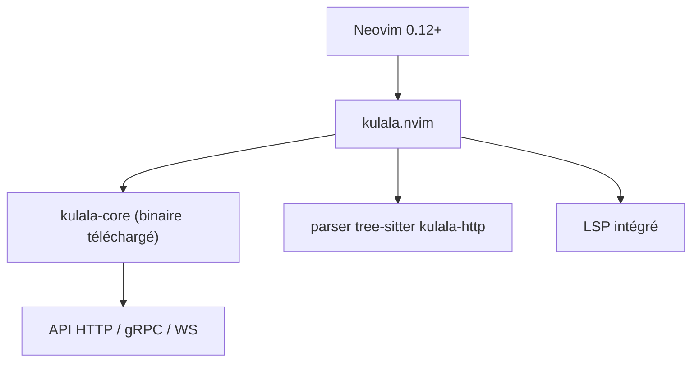

# mistweaverco/kulala.nvim

> Client HTTP, GraphQL, gRPC et WebSocket pour Neovim, compatible avec les fichiers `.http` de JetBrains.

## Le problème
Tester des API depuis l'éditeur évite de basculer vers Postman ou un terminal.

## Ce que ça fait vraiment
On exécute des requêtes écrites dans des fichiers `.http` (variables, scripts JavaScript, assertions, authentification Basic, Bearer, OAuth2, AWS, SSL), avec formatage des réponses, un explorateur OpenAPI, une complétion LSP intégrée et un bloc-notes. Le moteur est le binaire `kulala-core`, téléchargé automatiquement depuis core.kulala.app.

## Comment c'est branché
Schéma simplifié d'après la fiche, sans diagramme fourni.


## Essayer
```lua
require("lazy").setup({
  { "dont-be-evil-company/kulala.nvim", ft = {"http", "rest", "javascript"}, opts = {} },
})
```

## Coût et pièges
Neovim 0.12+, cURL, git et tree-sitter-cli. Le moteur kulala-core se télécharge depuis un serveur tiers et peut demander un jeton de licence (`KULALA_CORE_LICENSE_TOKEN`) ; ses conditions ne sont pas détaillées dans le README. Architectures x86_64 et arm64 (Windows : x86_64).

## Ce que ce n'est pas
Pas un client entièrement autonome : le cœur est un binaire séparé. Pas non plus une interface graphique.

## Alternatives
rest.nvim (a lancé le projet) et curl.nvim (bloc-notes plus simple pour des requêtes rapides).

## Pour toi
À surveiller : pratique si tu vis dans Neovim et testes des API, mais le binaire téléchargé et son éventuelle licence demandent un coup d'œil avant adoption.

