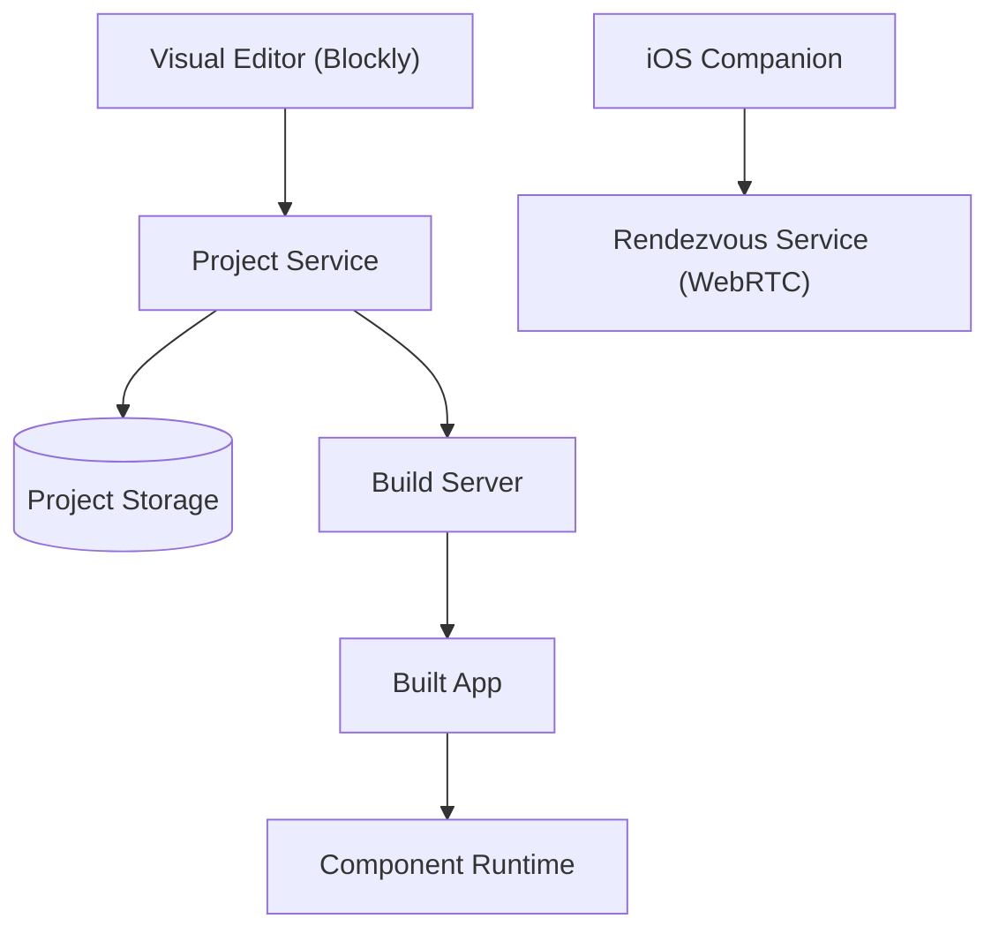

# mit-cml/appinventor-sources

> Sources of MIT App Inventor, the visual block-based environment for building mobile apps, to self-host.

## The problem
Building a mobile app requires code and a build environment; MIT App Inventor replaces them with blocks, but MIT's public instance is not always desirable.

## What it actually does
The repository contains the main server (projects stored in PostgreSQL), the Blockly editor, the build server that produces apk/aab files, the Android runtime components and an iOS companion (REPL over WebRTC). The README is mostly for running an instance or contributing. The Docker image builds for Docker or Kubernetes; App Engine is no longer supported.

## How it is wired


## Trying it
```bash
git submodule update --init
cd appinventor
ant MakeAuthKey
ant
cd appinventor/appinventor
ant devserver
```

## Cost and gotchas
JDK 11 or 17, ant 1.10+, PostgreSQL (17 or 18) with an appinventor_db database, Node 20+ and Firefox for tests, Ruby 3.3 for the docs. Compilation takes 2 to 10 minutes. The Vagrant route is flagged as untested for a long time.

## What it is not
Not a data or AI platform, and not necessary to build apps: MIT's public instance is enough. The sources are for those who want to operate their own instance or contribute.

## Alternatives
No alternative mentioned in the README.

## For you
Ignore: an education and block-based mobile app creation tool, unrelated to your data / AI / MLOps work, and heavy to self-host.
