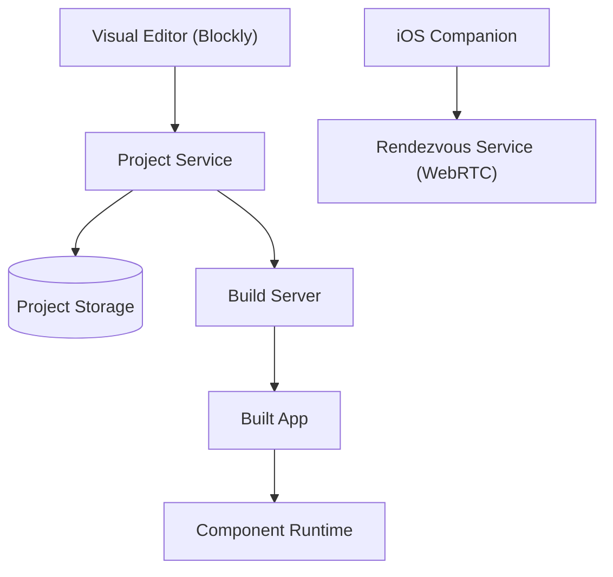

# mit-cml/appinventor-sources

> Sources de MIT App Inventor, l'environnement visuel par blocs pour créer des apps mobiles, à héberger soi-même.

## Le problème
Créer une app mobile exige du code et un environnement de build ; MIT App Inventor le remplace par des blocs, mais l'instance publique du MIT n'est pas toujours souhaitable.

## Ce que ça fait vraiment
Le dépôt contient le serveur principal (projets stockés dans PostgreSQL), l'éditeur Blockly, le serveur de build qui produit les fichiers apk/aab, les composants d'exécution Android et un compagnon iOS (REPL via WebRTC). Le README sert surtout à faire tourner une instance ou à contribuer. L'image Docker se construit pour Docker ou Kubernetes ; App Engine n'est plus pris en charge.

## Comment c'est branché


## Essayer
```bash
git submodule update --init
cd appinventor
ant MakeAuthKey
ant
cd appinventor/appinventor
ant devserver
```

## Coût et pièges
JDK 11 ou 17, ant 1.10+, PostgreSQL (17 ou 18) avec base appinventor_db, Node 20+ et Firefox pour les tests, Ruby 3.3 pour la doc. La compilation dure de 2 à 10 minutes. La voie Vagrant est signalée comme non testée depuis longtemps.

## Ce que ce n'est pas
Pas une plateforme de data ou d'IA, et pas nécessaire pour construire des apps : l'instance publique du MIT suffit. Les sources sont pour qui veut opérer sa propre instance ou contribuer.

## Alternatives
Aucune alternative citée dans le README.

## Pour toi
À ignorer : outil d'éducation et de création d'apps mobiles par blocs, sans rapport avec ton métier data / IA / MLOps, et lourd à héberger soi-même.

