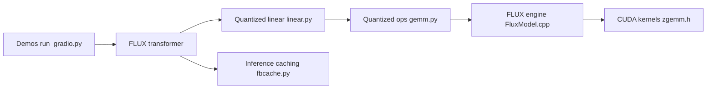

# mit-han-lab/nunchaku

> 4-bit inference engine (SVDQuant) for FLUX-type diffusion models, aimed at users with modest GPUs.

## The problem
A model like FLUX.1-dev (12 B) in BF16 saturates the memory of a consumer GPU and forces CPU offload, which is very slow.

## What it actually does
Implements SVDQuant, a 4-bit weight+activation post-training quantization that absorbs outlier values into low-rank components. The README quantifies 3.6× less memory on FLUX.1-dev and an 8.7× speedup over BF16 on a 16 GB laptop 4090 (without offload). The code mixes Python layers (transformers, LoRA, cache, PuLID) and a C++/CUDA core.

## How it is wired

## Trying it
The README gives no direct command: it points to the installation guide, the usage tutorial, the ComfyUI-nunchaku plugin and DeepCompressor to quantize your own models. Command not documented in the README.

## Cost and gotchas
An NVIDIA GPU is required (CUDA kernels). Quantized models must be available for your target model; quantizing your own goes through DeepCompressor.

## What it is not
Not a general-purpose inference server nor an engine for LLMs: oriented toward image generation. The speed figures come from the authors, measured on their hardware.

## Alternatives
- DeepCompressor: the underlying quantization library.
- QServe (same team): for serving quantized LLMs.

## For you
Worth watching if you run FLUX/PixArt on a 16 GB GPU: the memory gain is real according to the authors, but installation goes through external docs and depends on CUDA.
