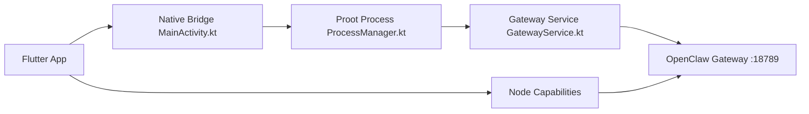

# mithun50/openclaw-termux

> Android (Flutter) app and Termux CLI to run the OpenClaw gateway on a phone.

## The problem
Running OpenClaw on Android requires a Linux environment, Node.js and Bionic workarounds.

## What it actually does
Installs, via proot, an Ubuntu with Node.js 22 and OpenClaw, without root. The Flutter app offers a terminal, gateway control, configuration of 9 providers (Anthropic, OpenAI, Gemini, Ollama...), SSH, logs and a web dashboard. A "node" mode exposes camera, location, screen and sensors to the AI.

## How it is wired


## Trying it
```bash
npm install -g openclaw-termux
openclawx setup
openclawx start
openclawx status
```

## Cost and gotchas
About 500 MB on first launch. Provider API keys are at your expense. The SSH server listens on 0.0.0.0:8022 with a root password: turn it off outside a trusted network. Disable battery optimization. Older versions asked for full storage access.

## What it is not
Not a local model: it relays to providers or a remote Ollama. It depends on OpenClaw, of which it is only the Android packaging.

## Alternatives
No alternative named in the README.

## For you
Keep an eye on it: interesting for trying an agent gateway on mobile, but the attack surface (SSH, sensors, storage) calls for caution.
