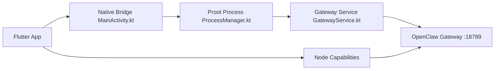

# mithun50/openclaw-termux

> App Android (Flutter) et CLI Termux pour faire tourner la passerelle OpenClaw sur un téléphone.

## Le problème
Faire tourner OpenClaw sur Android demande un environnement Linux, Node.js et des contournements Bionic.

## Ce que ça fait vraiment
Installe via proot un Ubuntu avec Node.js 22 et OpenClaw, sans root. L'app Flutter offre terminal, contrôle de la passerelle, configuration de 9 fournisseurs (Anthropic, OpenAI, Gemini, Ollama…), SSH, logs, tableau de bord web. Un mode « node » expose caméra, localisation, écran, capteurs à l'IA.

## Comment c'est branché


## Essayer
```bash
npm install -g openclaw-termux
openclawx setup
openclawx start
openclawx status
```

## Coût et pièges
Environ 500 Mo au premier lancement. Clés d'API de fournisseurs à ta charge. Le serveur SSH écoute sur 0.0.0.0:8022 avec mot de passe root : à couper hors du réseau de confiance. Désactiver l'optimisation batterie. Des versions anciennes ont demandé un accès complet au stockage.

## Ce que ce n'est pas
Pas un modèle local : il relaie vers des fournisseurs ou un Ollama distant. Dépend d'OpenClaw, dont il n'est que le packaging Android.

## Alternatives
Aucune alternative nommée dans le README.

## Pour toi
Surveiller : curieux pour essayer une passerelle d'agents sur mobile, mais la surface d'attaque (SSH, capteurs, stockage) impose de la prudence.

