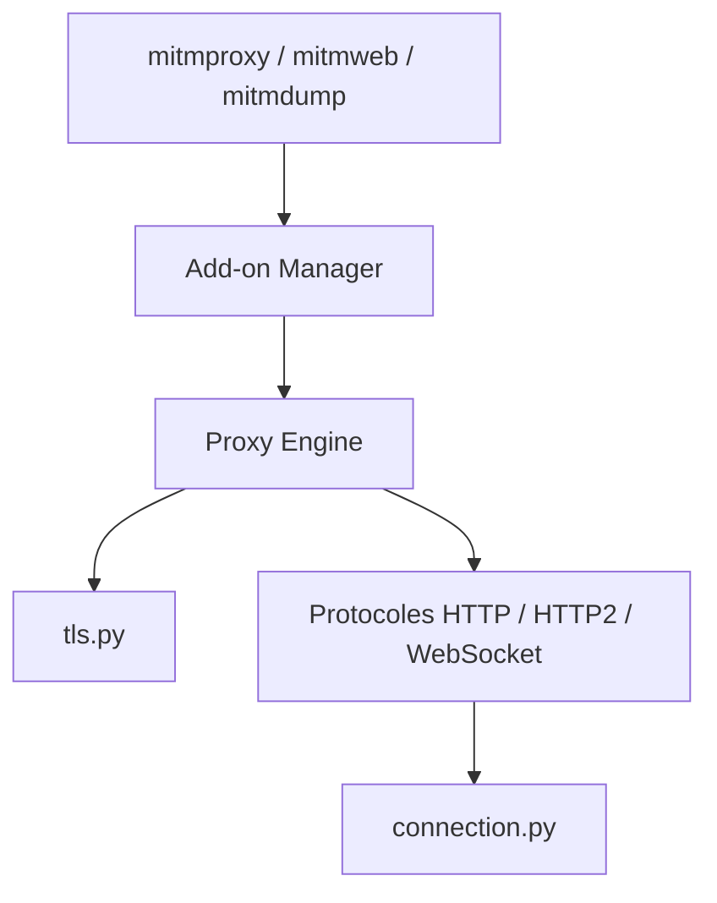

# mitmproxy/mitmproxy

> Intercepting proxy for HTTP/1, HTTP/2 and WebSocket, to inspect and modify traffic, aimed at developers and testers.

## The problem
Understanding what an application really exchanges with its servers (API clients, mobile apps, calls to a model) is hard without seeing the traffic.

## What it actually does
- Three interfaces: `mitmproxy` (console), `mitmdump` (command line, "tcpdump for HTTP"), `mitmweb` (web).
- SSL/TLS-compatible interception.
- An add-on and script system to observe or modify flows.
- Support for several proxy modes, HTTP/2 and WebSocket.

## How it is wired

## Trying it
The README contains no command: it points to the project website for installation and to CONTRIBUTING.md for installation from source.

## Cost and gotchas
Free. TLS decryption requires installing a certificate authority on the observed device; this detail is not documented in the README. Use it only on your own traffic or with authorization.

## What it is not
Not a low-level packet analysis tool nor a firewall. Placing a proxy on other people's traffic without consent is illegal in many countries.

## Alternatives
No alternative named in the README.

## For you
Adopt: handy for debugging the HTTP calls of a pipeline, an agent or a model API, with a Python script as an add-on; MIT license and an old, active project.
