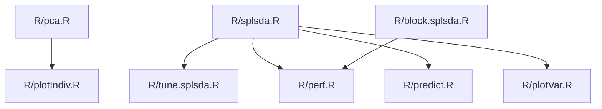

# mixOmics-org/mixOmics

> Bioconductor package for multivariate analysis of omics data, for biostatisticians working in R.

## The problem
Integrating several omics datasets (genomics, proteomics) and selecting the useful variables requires suitable multivariate methods.

## What it actually does
Provides PCA, sparse PLS-DA, DIABLO (multi-block) and MINT (multi-study). Models are tuned with tune, evaluated with perf and predict, then explored with plotIndiv, plotVar, cim or circosPlot. The README mostly details the version history.

## How it is wired


## Trying it
```r
BiocManager::install('mixOmics')
library(mixOmics)
```

## Cost and gotchas
Free. macOS requires XQuartz. A 4.4 GB Docker image with RStudio is available. No license is declared in the catalog.

## What it is not
Not a general-purpose machine learning framework: it targets exploratory analysis and variable selection in omics.

## Alternatives
No alternative named in the README.

## For you
Worth watching: relevant if you work in biology with R, otherwise outside your scope.
