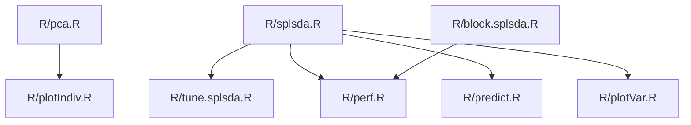

# mixOmics-org/mixOmics

> Package Bioconductor d'analyse multivariée de données omiques, pour biostatisticiens travaillant en R.

## Le problème
Intégrer plusieurs jeux de données omiques (génomique, protéomique) et sélectionner les variables utiles demande des méthodes multivariées adaptées.

## Ce que ça fait vraiment
Fournit ACP, PLS-DA parcimonieuse, DIABLO (multi-blocs) et MINT (multi-études). Les modèles se règlent avec tune, s'évaluent avec perf et predict, puis s'explorent par plotIndiv, plotVar, cim ou circosPlot. Le README détaille surtout l'historique des versions.

## Comment c'est branché


## Essayer
```r
BiocManager::install('mixOmics')
library(mixOmics)
```

## Coût et pièges
Gratuit. macOS demande XQuartz. Image Docker de 4,4 Go avec RStudio disponible. Aucune licence n'est déclarée dans le catalogue.

## Ce que ce n'est pas
Pas un cadre d'apprentissage automatique généraliste : il vise l'analyse exploratoire et la sélection de variables en omique.

## Alternatives
Aucune alternative nommée dans le README.

## Pour toi
À surveiller : pertinent si tu travailles en biologie sur R, sinon hors de ton périmètre.

