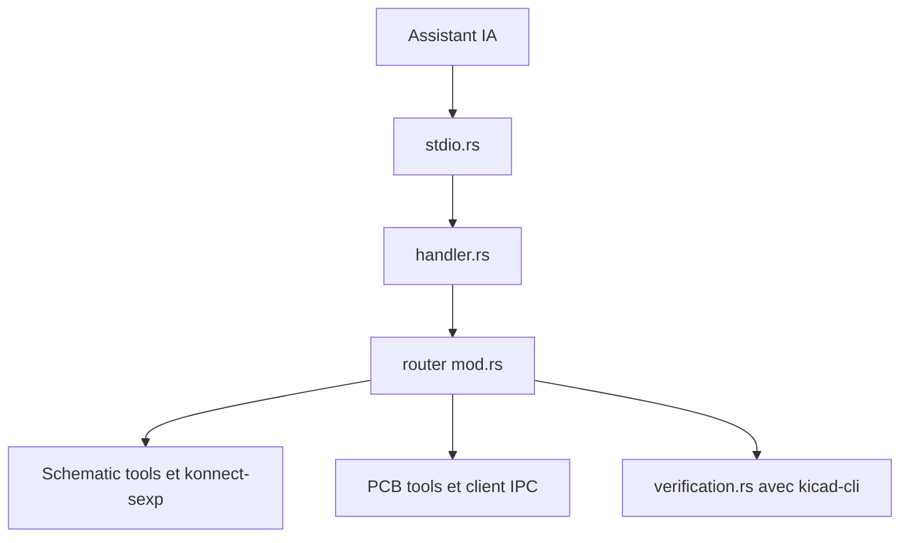

# mixelpixx/Konnect

> KiCad plugin as a Rust binary that lets Claude design schematics and printed circuit boards via MCP.

## The problem
Designing a printed circuit board by hand is slow, and the old KiCad MCP server stacked Node, Python and SWIG with many points of failure.

## What it actually does
- 228 MCP tools split into 21 sets loaded on demand, to limit context.
- Edits `.kicad_sch` files directly and drives the board live through the KiCad 10 IPC API.
- ERC, DRC, Gerber and BOM exports via `kicad-cli`, JLCPCB part search, reference circuits.
- Specctra routing via Freerouting.

## How it is wired


## Trying it
```bash
cargo build --release -p konnect
konnect init
codex mcp add konnect -- /path/to/konnect --client codex
```

## Cost and gotchas
Archived repository: development continues in Konnect-EDA, commercial and closed, free before 1.0 then paid for companies. Building requires `protoc` and `cmake`; KiCad 10 required.

## What it is not
Not the original KiCad MCP server (MIT license, still maintained). The macOS binaries are not signed.

## Alternatives
- KiCAD-MCP-Server: the original under the MIT license, still maintained.

## For you
Ignore: an archived electronics tool moving to commercial; only the on-demand-loading MCP angle is worth remembering.
