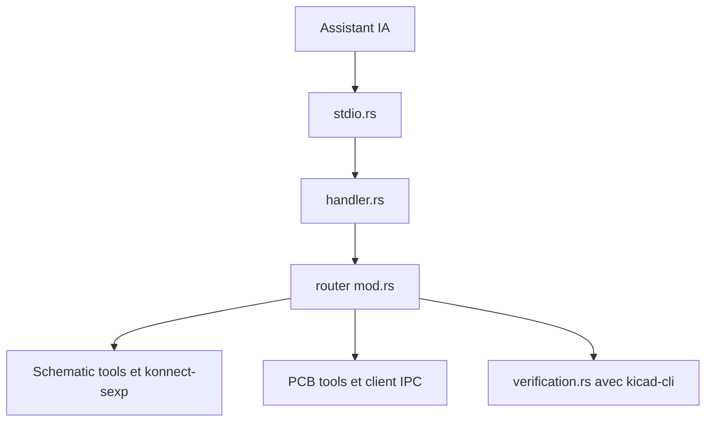

# mixelpixx/Konnect

> Plugin KiCad en binaire Rust qui laisse Claude concevoir schémas et circuits imprimés via MCP.

## Le problème
Concevoir un circuit imprimé à la main est long, et l'ancien serveur MCP de KiCad empilait Node, Python et SWIG avec de nombreux points de panne.

## Ce que ça fait vraiment
- 228 outils MCP répartis en 21 jeux chargés à la demande, pour limiter le contexte.
- Édite les fichiers `.kicad_sch` directement et pilote la carte en direct via l'API IPC de KiCad 10.
- ERC, DRC, exports Gerber et BOM via `kicad-cli`, recherche de pièces JLCPCB, circuits de référence.
- Routage Specctra via Freerouting.

## Comment c'est branché


## Essayer
```bash
cargo build --release -p konnect
konnect init
codex mcp add konnect -- /path/to/konnect --client codex
```

## Coût et pièges
Dépôt archivé : le développement continue dans Konnect-EDA, commercial et fermé, gratuit avant la 1.0 puis payant pour les entreprises. Compiler demande `protoc` et `cmake` ; KiCad 10 requis.

## Ce que ce n'est pas
Pas le serveur MCP KiCad d'origine (licence MIT, toujours maintenu). Les binaires macOS ne sont pas signés.

## Alternatives
- KiCAD-MCP-Server : l'original sous licence MIT, toujours maintenu.

## Pour toi
À ignorer : outil d'électronique archivé qui bascule vers du commercial ; seul l'angle MCP à chargement à la demande est intéressant à retenir.

