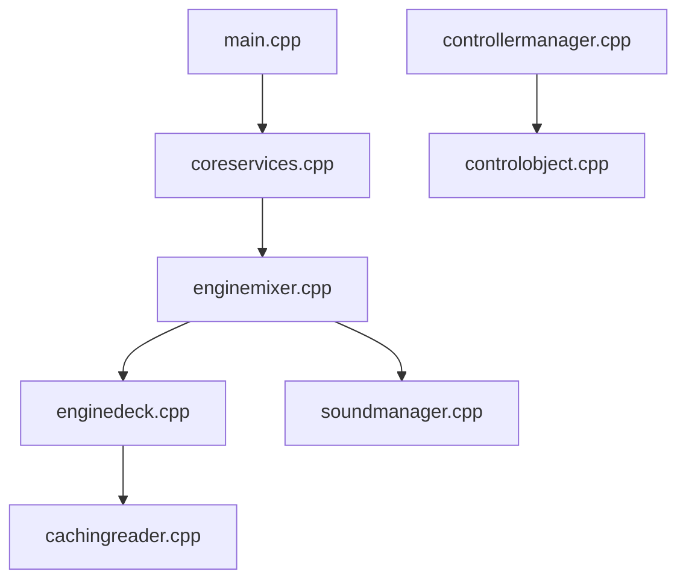

# mixxxdj/mixxx

> Free DJ software for live mixing on Linux, Windows and macOS.

## The problem
Professional DJ software is proprietary and paid.

## What it actually does
C++/Qt desktop application: decks, samplers, effects, SQLite music library, track analysis (waveform, tempo, key), MIDI and HID controllers with JavaScript scripts, timecode vinyl control, recording and Icecast broadcasting, QML interface and XML skins.

## How it is wired


## Trying it
```bash
git clone https://github.com/mixxxdj/mixxx.git
# Usage normal : télécharger la version stable depuis le site (lien dans le README)
```

## Cost and gotchas
Free. The build uses CMake; instructions are in CONTRIBUTING.md (not detailed here).

## What it is not
Not a data or AI tool. The diagram suggests a GPLv2 license, but GitHub does not identify it: to be verified.

## Alternatives
No alternative named in the README.

## For you
Ignore for your profile: good software, but unrelated to data, AI or MLOps.
