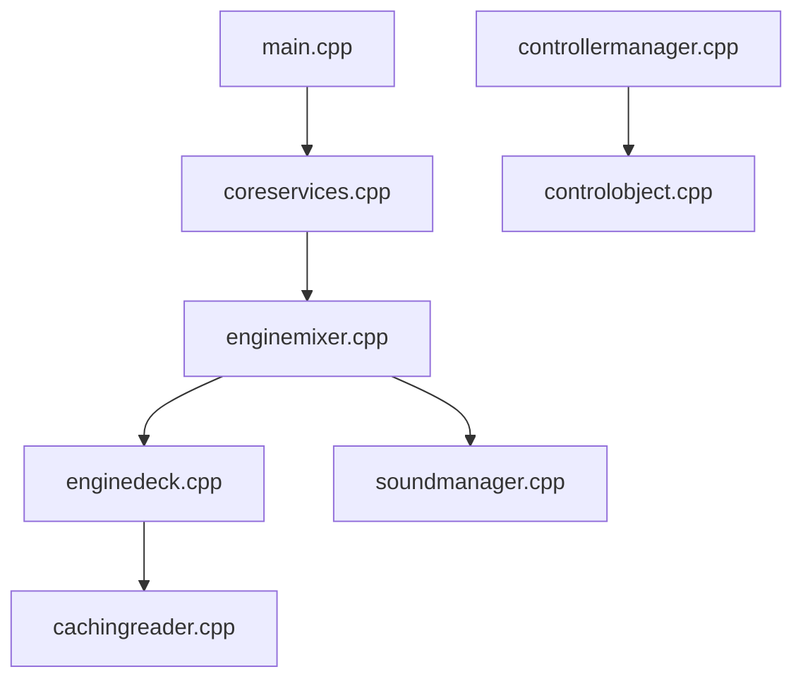

# mixxxdj/mixxx

> Logiciel libre de DJ pour mixer en direct sous Linux, Windows et macOS.

## Le problème
Les logiciels de DJ professionnels sont propriétaires et payants.

## Ce que ça fait vraiment
Application de bureau C++/Qt : decks, échantillonneurs, effets, bibliothèque musicale en SQLite, analyse de pistes (forme d'onde, tempo, tonalité), contrôleurs MIDI et HID avec scripts JavaScript, contrôle par disque vinyle à timecode, enregistrement et diffusion Icecast, interface QML et skins XML.

## Comment c'est branché


## Essayer
```bash
git clone https://github.com/mixxxdj/mixxx.git
# Usage normal : télécharger la version stable depuis le site (lien dans le README)
```

## Coût et pièges
Gratuit. La compilation passe par CMake ; instructions dans CONTRIBUTING.md (non détaillées ici).

## Ce que ce n'est pas
Pas un outil de données ni d'IA. Le diagramme évoque une licence GPLv2, mais GitHub ne l'identifie pas : à vérifier.

## Alternatives
Aucune alternative nommée dans le README.

## Pour toi
À ignorer pour ton profil : bon logiciel, mais sans lien avec data, IA ou MLOps.

