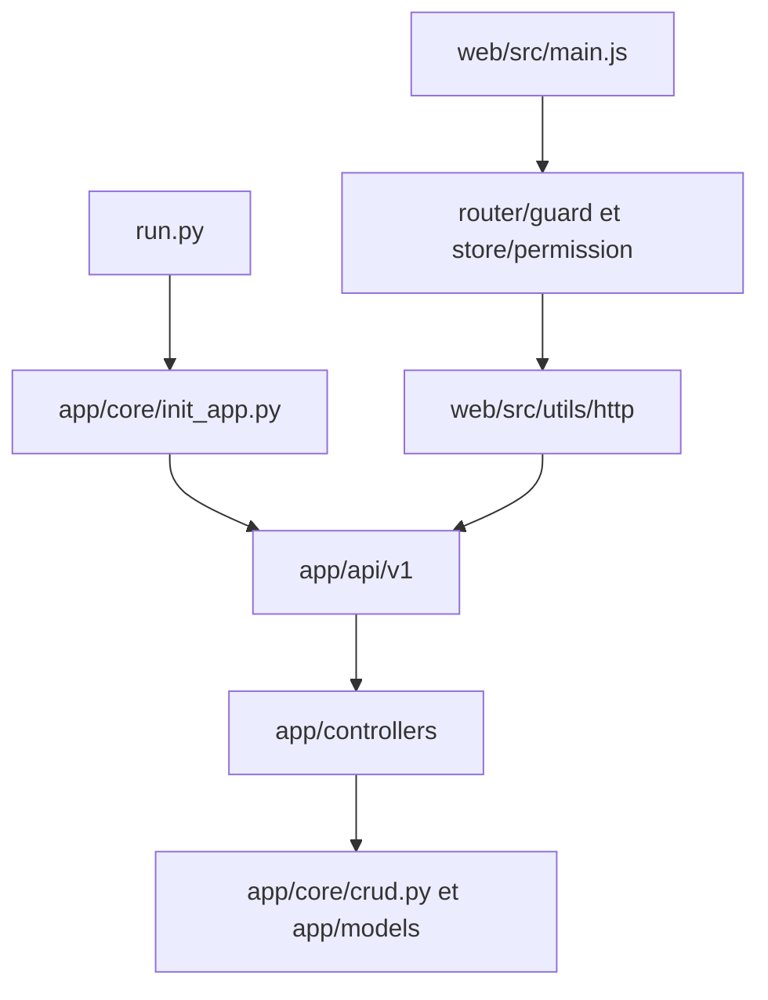

# mizhexiaoxiao/vue-fastapi-admin

> A FastAPI and Vue 3 admin interface template with role management, for small applications.

## The problem
Every internal back office asks for the same building blocks: login, roles, menus, per-API permissions. Rebuilding them for each project is wasted time.

## What it actually does
A FastAPI backend (/api/v1 routes, controllers, shared CRUD, models, schemas) and a Vue 3 front end with Naive UI and Pinia. JWT authentication, RBAC permissions at menu, button and API level, dynamic routes by role, an audit log. The README is in Chinese; an online demo is announced.

## How it is wired


## Trying it
```bash
docker pull mizhexiaoxiao/vue-fastapi-admin:latest
docker run -d --restart=always --name=vue-fastapi-admin -p 9999:80 mizhexiaoxiao/vue-fastapi-admin
```
Then http://localhost:9999 (credentials admin / 123456, to be changed).

## Cost and gotchas
Free. The default account admin / 123456 is published in the README: change it before any use. The README also offers donation links and custom development.

## What it is not
Not a data or AI tool: a general-purpose web template. The last push dates from July 2025, so over a year without an update. The README states it is for small and medium applications or for learning.

## Alternatives
No alternative named in the README.

## For you
Ignore for a data / AI / MLOps profile: it is a web back-office template, outside your scope, and has gone without an update for over a year.
