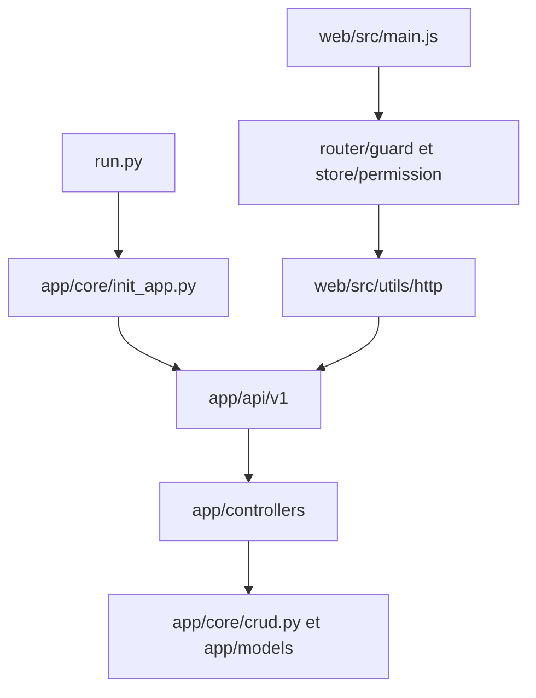

# mizhexiaoxiao/vue-fastapi-admin

> Un modèle d'interface d'administration FastAPI et Vue 3 avec gestion des rôles, pour petites applications.

## Le problème
Chaque back-office interne redemande les mêmes briques : connexion, rôles, menus, droits par API. Les refaire à chaque projet est du temps perdu.

## Ce que ça fait vraiment
Un backend FastAPI (routes /api/v1, contrôleurs, CRUD partagé, modèles, schémas) et un front Vue 3 avec Naive UI et Pinia. Authentification par JWT, permissions RBAC au niveau menu, bouton et API, routes dynamiques selon le rôle, journal d'audit. Le README est en chinois, une démo en ligne est annoncée.

## Comment c'est branché


## Essayer
```bash
docker pull mizhexiaoxiao/vue-fastapi-admin:latest
docker run -d --restart=always --name=vue-fastapi-admin -p 9999:80 mizhexiaoxiao/vue-fastapi-admin
```
Puis http://localhost:9999 (identifiants admin / 123456, à changer).

## Coût et pièges
Gratuit. Le compte par défaut admin / 123456 est publié dans le README : à changer avant tout usage. Le README propose aussi des liens de dons et de développement sur mesure.

## Ce que ce n'est pas
Pas un outil data ou IA : un gabarit web généraliste. Le dernier push date de juillet 2025, donc plus d'un an sans mise à jour. Le README précise que c'est pour petites et moyennes applications ou pour l'apprentissage.

## Alternatives
Aucune alternative nommée dans le README.

## Pour toi
À ignorer pour un profil data / IA / MLOps : c'est un gabarit de back-office web, hors de ton périmètre, et il est resté sans mise à jour depuis plus d'un an.

