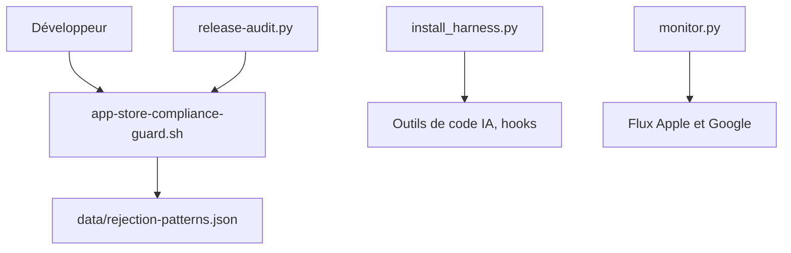

# mjmirza/app-store-compliance

> Guide and automated guard that scans an iOS or Android app to prevent store rejections.

## The problem
A rejection by Apple or Google costs a week of cycle time; the causes (privacy manifest, demo account) are often known but forgotten.

## What it actually does
A shell script analyzes an Xcode or Android project and flags rejection risks, with file, line and fix; it ends with `BLOCKED.`, `CLEAR.` or `NOT CHECKED.`. An installer hooks it in before submission commands in Claude Code, Codex, Gemini CLI, Cursor and others. Policy monitors and audits round out the set.

## How it is wired


## Trying it
```bash
git clone https://github.com/mjmirza/app-store-compliance ~/repositories/app-store-compliance
bash ~/repositories/app-store-compliance/agent-os/hooks/app-store-compliance-guard.sh "/path/to/your/app"
```

## Cost and gotchas
Free; git and bash, plus python3 for all tools except Claude Code. License not identified by GitHub. The installer modifies your tools' configurations (a backup is made). The monitors read sample data without the `--live` option.

## What it is not
It is not a guarantee of approval: a code scan cannot see the state of the developer account. The README's statistics and testimonials are the author's own.

## Alternatives
No alternative named in the README.

## For you
Ignore: only useful if you publish mobile apps, unrelated to data / AI work.
