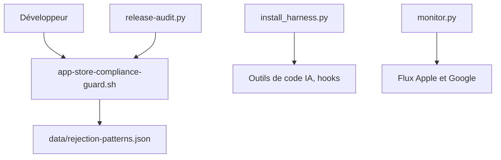

# mjmirza/app-store-compliance

> Guide et garde automatisée qui scanne une app iOS ou Android pour prévenir les rejets des stores.

## Le problème
Un rejet par Apple ou Google coûte une semaine de cycle ; les causes (manifeste de confidentialité, compte démo) sont souvent connues mais oubliées.

## Ce que ça fait vraiment
Un script shell analyse un projet Xcode ou Android et signale les risques de rejet, avec fichier, ligne et correction ; il se termine par `BLOCKED.`, `CLEAR.` ou `NOT CHECKED.`. Un installateur le branche comme hook avant les commandes de soumission dans Claude Code, Codex, Gemini CLI, Cursor et d'autres. Des moniteurs de politiques et des audits complètent l'ensemble.

## Comment c'est branché


## Essayer
```bash
git clone https://github.com/mjmirza/app-store-compliance ~/repositories/app-store-compliance
bash ~/repositories/app-store-compliance/agent-os/hooks/app-store-compliance-guard.sh "/path/to/your/app"
```

## Coût et pièges
Gratuit ; git et bash, et python3 pour tous les outils sauf Claude Code. Licence non identifiée par GitHub. L'installateur modifie les configurations de tes outils (une sauvegarde est faite). Les moniteurs lisent des données d'exemple sans l'option `--live`.

## Ce que ce n'est pas
Ce n'est pas une garantie d'approbation : un scan de code ne voit pas l'état du compte développeur. Statistiques et témoignages du README sont ceux de l'auteur.

## Alternatives
Aucune alternative nommée dans le README.

## Pour toi
À ignorer : utile seulement si tu publies des apps mobiles, sans lien avec le travail data / IA.

