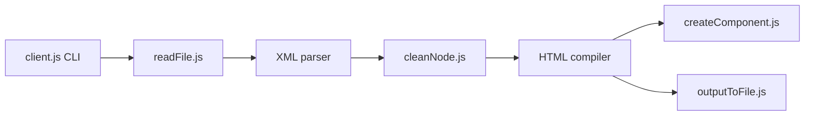

# mjmlio/mjml

> Markup language that compiles to responsive email HTML, created by Mailjet.

## The problem
Hand-writing email HTML that works across all mail clients is painful and fragile.

## What it actually does
You write semantic tags (`mj-section`, `mj-column`, `mj-text`...); the engine parses, validates, renders the components and outputs responsive HTML. Usable as a CLI (file, stdin, watch, beautify/minify), in Node (`mjml2html`) or in the browser (`mjml-browser`). Custom components via `.mjmlconfig`; `mj-include` is disabled by default. An online editor and a free API are mentioned.

## How it is wired


## Trying it
```bash
npm install mjml
mjml input.mjml -o output.html
```

## Cost and gotchas
Free. The repo requires yarn for development. Security options around includes and CSS need to be configured if templates come from third parties.

## What it is not
Not a sending service: it only produces the HTML.

## Alternatives
No alternative named in the README.

## For you
Relevant for email alerts or reports coming out of a pipeline; otherwise of no interest.
