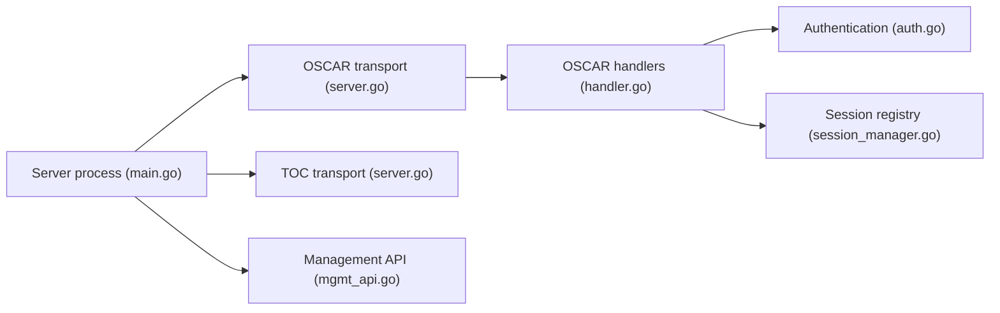

# mk6i/open-oscar-server

> Instant messaging server in Go compatible with old AIM and ICQ clients, for nostalgics and retro-computing fans.

## The problem
Period AIM and ICQ clients no longer have an official server to connect to.

## What it actually does
- Handles messages, contact lists, chat rooms, profiles, away messages, privacy, directory search, file sharing.
- Windows clients AIM 1.x to 7.x, ICQ 98 to 5, TOC1 and TOC2 clients.
- HTTP management API (port 8080): users, sessions, public chat rooms.
- Independent project, not affiliated with AOL or Yahoo.

## How it is wired


## Trying it
```bash
curl http://localhost:8080/user
curl -d'{"screen_name":"MyScreenName", "password":"thepassword"}' http://localhost:8080/user
curl http://localhost:8080/session
```
Installation goes through Linux, macOS and Windows guides not detailed in the README.

## Cost and gotchas
Free. The management API has no authentication documented in the README: do not expose it on an open network.

## What it is not
Not a modern or encrypted messenger: a server for the old AIM and ICQ clients.

## Alternatives
No alternative named in the README.

## For you
Ignore: a retro project unrelated to data/AI/MLOps.
