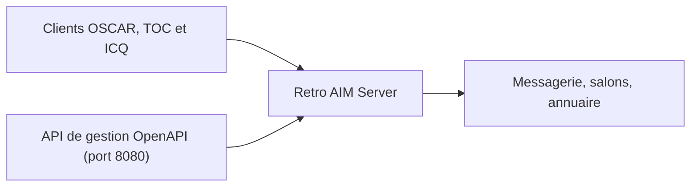

# mk6i/retro-aim-server

> Messaging server in Go compatible with classic AIM and ICQ clients, for the nostalgic.

## The problem
Period AIM and ICQ clients no longer have an official server.

## What it actually does
Implements the OSCAR protocol: messaging, buddy lists, chat rooms, profiles, away messages, icons, directory search, file transfer, TOC1/TOC2 and ICQ clients. A management API (OpenAPI) on port 8080 lets you create users, change passwords, and list sessions and rooms. Not affiliated with AOL or Yahoo.

## How it is wired
Simplified diagram based on the sheet, no diagram provided.



## Trying it
```bash
curl http://localhost:8080/user
curl -d'{"screen_name":"MyScreenName", "password":"thepassword"}' http://localhost:8080/user
curl http://localhost:8080/session
```

## Cost and gotchas
Free. The management API over plain HTTP on localhost has no documented authentication.

## What it is not
Not a modern messenger: it only serves period clients. The README claims to have no revenue or donations.

## Alternatives
No alternative named in the README.

## For you
Ignore: retro server unrelated to data or AI.
